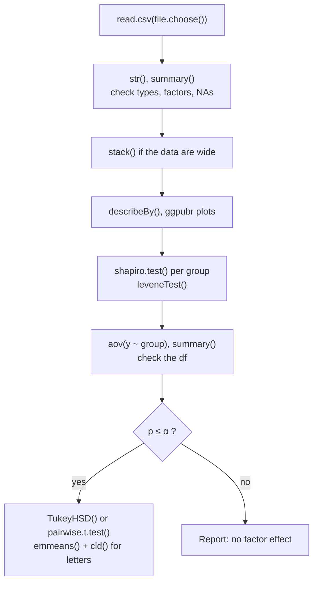

> [!tip] New to this?
> Read the first group in order. After that, each note covers one function, so jump to whichever one your script uses.

How to work in R, from opening RStudio to the letters that show which groups differ.

R is a very literal colleague. It does exactly what you say, never what you meant, and it rarely complains. Most R mistakes in statistics aren't coding errors. They're silent misunderstandings: a group column read as a number, rows dropped without a word. So the notes here focus on what each function needs from you and how to check that it got it. Learn to check the output against what you expected, and R becomes a tool you can trust.

## 1. Getting started
- [[RStudio and Scripts]]: always work in a saved script
- [[R Objects and Assignment]]: storing a value under a name with `<-`
- [[Functions and Arguments]]: what goes inside the parentheses
- [[R Packages]]: install once, then load in every session
- [[c() and Vectors]]: R's basic list of values
- [[Data Frames]]: R's version of a spreadsheet

## 2. Reading and checking data
- [[read.csv() and file.choose()]]: getting the file into R
- [[str()]]: how R stored each column
- [[factor()]]: telling R that a column holds groups
- [[summary()]]: a quick overview of every column
- [[na.omit() and complete.cases()]]: dropping rows with missing values, on purpose
- [[Wide vs Long Format]] and [[stack()]]: reshaping the data for an ANOVA

## 3. Describing and plotting
- [[mean() and sd()]]: the mean and the standard deviation, and why `na.rm = TRUE` matters when values are missing
- [[describe() and describeBy()]]: many summaries at once, for all the data or for each group
- [[aggregate() and by()]]: one statistic for each group
- [[report()]]: a summary table (the "Table 1" of a paper) and written summaries
- [[hist() and boxplot()]]: quick plots in base R
- [[ggpubr Plots]]: plots ready for a report or a paper

## 4. Testing
- [[shapiro.test()]]: checks whether the data look normal
- [[leveneTest()]]: checks whether the groups have equal variances
- [[t.test()]]: one-sample, paired and two-sample t-tests
- [[cohensD()]]: the effect size for t-tests
- [[power.t.test()]]: sample size and power
- [[pnorm(), qnorm(), pt() and qt()]]: areas and cut-offs without printed tables
- [[wilcox.test() and kruskal.test()]]: the tests based on ranks, used as a check
- [[aov()]]: one-way ANOVA
- [[TukeyHSD()]]: compares every pair of groups, adjusted for the number of tests
- [[pairwise.t.test()]]: a table of t-tests for every pair, with the Bonferroni adjustment
- [[emmeans() and cld()]]: letters that show which groups differ

## See it as a flowchart

The order of a typical ANOVA script, from reading in the file to the letters.

## Why notes on this topic
- [[Why visualize data before testing]]
- [[Why check assumptions before trusting a test]]
- [[Why use degrees of freedom as a sanity check]]
- [[Why R must be told what kind of variable it has]]
- [[Why you must say how missing values were handled]]
- [[Why we hope for a large p-value on assumption checks]]

## Other maps
[[MOC - Describing Data]] · [[MOC - t-Tests]] · [[MOC - ANOVA]] · [[index|Home]]
