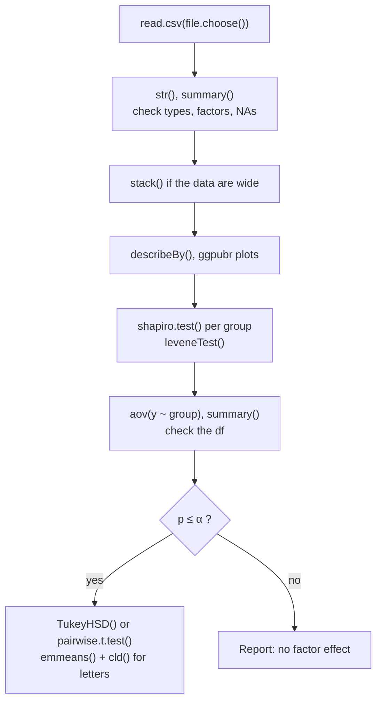

> [!tip] New to this?
> Read the first group in order. After that, each note is one function, so jump to whichever one the script in front of me uses.

The R workflow, from opening RStudio to post hoc letters.

## 1. Getting started
- [[RStudio and Scripts]]: always work in a saved script
- [[R Objects and Assignment]]: `<-`
- [[Functions and Arguments]]: what goes in the parentheses
- [[R Packages]]: install once, load every session
- [[c() and Vectors]]: R's basic list
- [[Data Frames]]: R's spreadsheet

## 2. Reading and checking data
- [[read.csv() and file.choose()]]: getting the file in
- [[str()]]: how R stored each column
- [[factor()]]: making groups categorical
- [[summary()]]: the quick overview
- [[na.omit() and complete.cases()]]: dropping missing rows on purpose
- [[Wide vs Long Format]] and [[stack()]]: reshaping for ANOVA

## 3. Describing and plotting
- [[mean() and sd()]]: and `na.rm = TRUE`
- [[describe() and describeBy()]]: everything at once, overall or by group
- [[aggregate() and by()]]: one statistic per group
- [[report()]]: Table 1 and text summaries
- [[hist() and boxplot()]]: base R's quick looks
- [[ggpubr Plots]]: publication-ready plots

## 4. Testing
- [[shapiro.test()]]: normality
- [[leveneTest()]]: equal variances
- [[t.test()]]: one-sample, paired, two-sample
- [[cohensD()]]: effect size for t-tests
- [[power.t.test()]]: sample size and power
- [[pnorm(), qnorm(), pt() and qt()]]: areas and cut-offs without tables
- [[wilcox.test() and kruskal.test()]]: the rank-based checks
- [[aov()]]: one-way ANOVA
- [[TukeyHSD()]]: all pairs, adjusted
- [[pairwise.t.test()]]: Bonferroni matrix
- [[emmeans() and cld()]]: letters

## See it as a flowchart

*What to look at:* the order of a typical ANOVA script, from reading the file to letters.

## Related molecular notes
- [[Why visualize data before testing]]
- [[Why check assumptions before trusting a test]]
- [[Why use degrees of freedom as a sanity check]]
- [[Why R must be told what kind of variable it has]]
- [[Why you must say how missing values were handled]]
- [[Why we hope for a large p-value on assumption checks]]

## Related MOCs
[[MOC - Describing Data]] · [[MOC - t-Tests]] · [[MOC - ANOVA]] · [[index|Home]]
