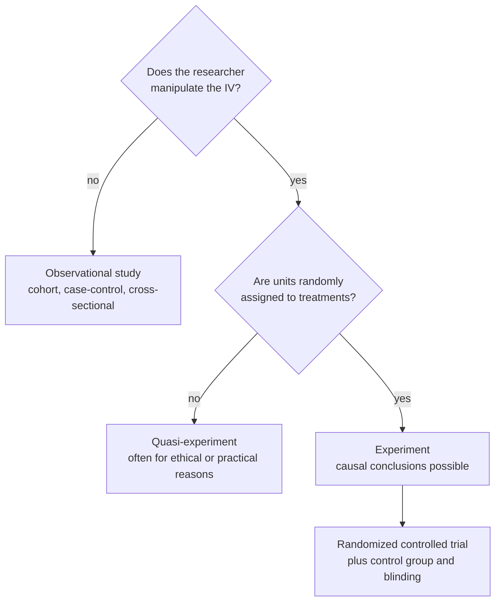

Why isn't the randomized controlled trial (RCT), the gold standard, always the best design?

The more tightly a study controls who gets what and under which [[Test Assumptions|conditions]], the more confidently it can claim [[Association vs Causation|causation]], but the less its setting looks like real life. Randomized trials score highest for control, which is internal validity, and often lower for how well results carry over to other settings, which is external validity. Observational designs are the reverse.

Two yes-or-no questions about the independent variable (IV) separate the three kinds of study, and only the bottom path supports a causal claim.

1. [[Random Assignment|Random assignment]], blinding and placebo controls remove [[Nuisance Variables and Confounding|confounding]], so internal validity is highest in a randomized trial ([[Randomized Controlled Trial]]).
2. But the participants are volunteers, who may differ from typical patients, and the strict trial routine doesn't match real life, so the results may not carry over ([[External Validity]]).
3. A cohort study follows people in their real lives, so its results carry over better, but it can't assign exposures, so its internal validity is weaker ([[Observational Study Designs]]).
4. Case-control and cross-sectional designs are cheaper and faster, with less control again.
5. Randomized trials are also impractical for rare outcomes, and unethical for harmful exposures. There, only observational or quasi-experimental designs are possible ([[Quasi-Experiment]]).

Treating trial results as universal would ignore who was studied. And dismissing observational studies would leave rare diseases and harmful exposures unstudied; it was long cohort studies that first linked smoking to heart disease.

See also: [[Internal Validity]], [[Blinding and Placebo]], [[Why random assignment and random sampling protect different things]], [[Experiment]].
