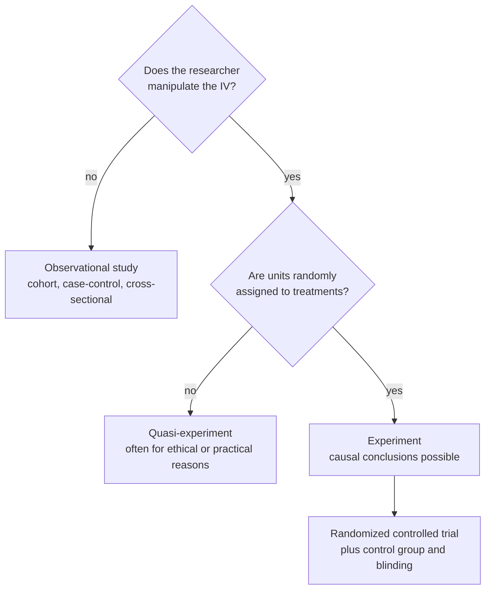

Why isn't the randomized controlled trial (RCT), the gold standard, always the best design?

Because control and realism pull in opposite directions. The more tightly a study controls who gets what and under which [[Test Assumptions|conditions]], the more confidently it can claim [[Association vs Causation|causation]], and the less its setting looks like real life. Randomized trials win on control, which is internal validity. They often lose on how well the results carry over to other people and places, which is external validity. Observational designs make the opposite trade. There's no design that wins both.

Two yes-or-no questions about the independent variable (IV) separate the three kinds of study, and only the bottom path supports a causal claim.

Start with what a trial buys. [[Random Assignment|Random assignment]] balances the groups on everything, known and unknown. Blinding and placebo controls stop expectations from leaking in. Together they strip out [[Nuisance Variables and Confounding|confounding]], so when the groups differ at the end, the treatment is the only explanation left. That's why internal validity is highest in a randomized trial ([[Randomized Controlled Trial]]).

Now look at the price. The people in a trial are volunteers who passed strict entry rules, and they may not look like the patients who walk into a clinic. They follow a routine that real life never would. So the result is clean, but it was found in a clean world, and it may not carry over to a messy one ([[External Validity]]).

A cohort study makes the other trade. It follows people as they actually live, so what it finds carries over well. But it can't decide who is exposed to what, so it can never fully rule out that something else drove the outcome. Its internal validity is weaker ([[Observational Study Designs]]). Case-control and cross-sectional studies go further in that direction: cheaper and faster, with less control again.

And sometimes a trial isn't even an option. It's impractical for rare outcomes, and unethical for harmful exposures. You can't assign people to smoke. There, only observational or quasi-experimental designs are possible ([[Quasi-Experiment]]).

So "gold standard" means "best for proving cause", not "best for everything". Treat trial results as universal and you ignore who was studied. Dismiss observational studies and you leave rare diseases and harmful exposures unstudied; it was long cohort studies that first linked smoking to heart disease. Every design answers some questions well and others badly. The skill is knowing which question you're asking.

See also: [[Internal Validity]], [[Blinding and Placebo]], [[Why random assignment and random sampling protect different things]], [[Experiment]].
