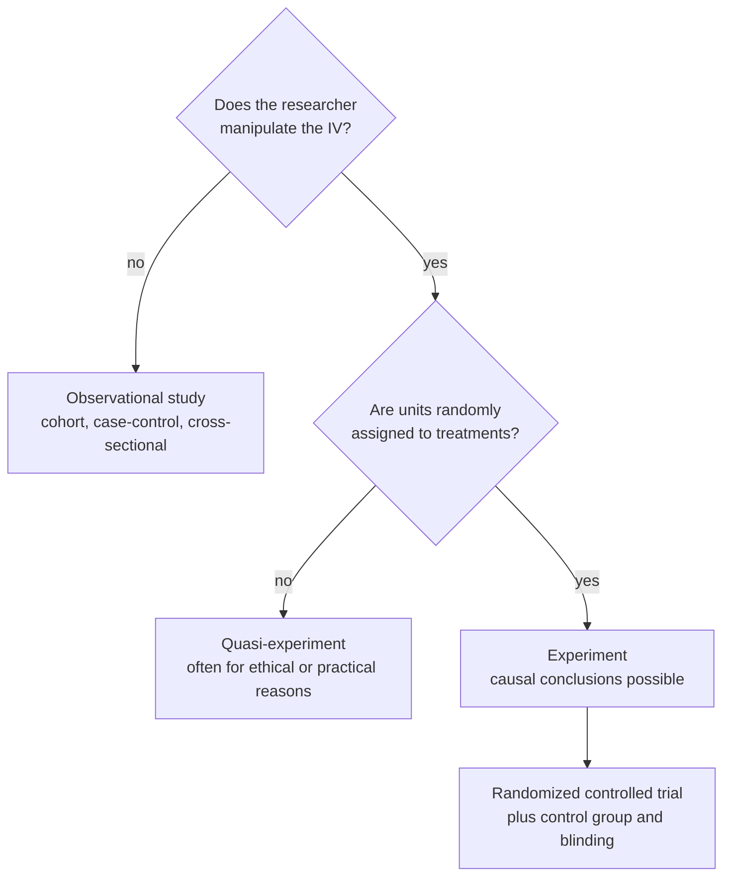

Why isn't the gold-standard RCT always the best design?

The more tightly a study controls who gets what and under which [[Test Assumptions|conditions]], the more confidently it can claim [[Association vs Causation|causation]], but the less its setting looks like real life. RCTs sit at the top for control (internal validity) and often lower for generalizability (external validity); observational designs are the reverse.

Two yes/no questions separate the three kinds of study, and only the bottom path supports a causal claim.

1. [[Random Assignment|Random assignment]], blinding and placebo controls remove [[Nuisance Variables and Confounding|confounding]]: internal validity is highest in an RCT ([[Randomized Controlled Trial]]).
2. But participants are volunteers ("odd, desperate, etc."), and enforced adherence doesn't match real life, so results may not generalize ([[External Validity]]).
3. A cohort follows people in their real lives (better generalizability) but can't assign exposures, so internal validity "starts to sag" ([[Observational Study Designs]]).
4. Case-control and cross-sectional designs are cheaper and faster, with less control again.
5. RCTs are also impractical for rare outcomes or unethical exposures, where only observational or quasi-experimental designs are possible ([[Quasi-Experiment]]).

- Treating RCT results as universal would ignore who was studied.
- Dismissing observational studies would leave rare diseases and harmful exposures unstudied; long cohorts first linked smoking to heart disease.

See also: [[Internal Validity]], [[Blinding and Placebo]], [[Why random assignment and random sampling protect different things]], [[Experiment]].
