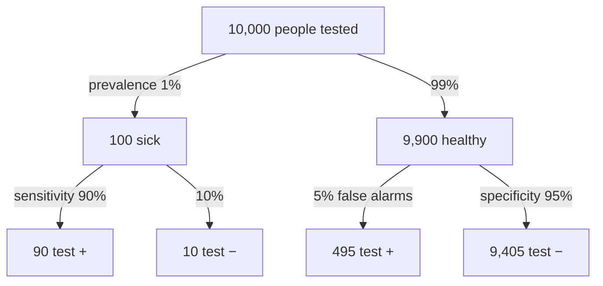

A mammogram has a sensitivity of 0.89 and a specificity of 0.93. How can a positive result mean only about a 4% chance of cancer?

Because when a condition is rare, false alarms can outnumber true hits. Healthy people vastly outnumber sick ones. A small false-positive rate, applied to that huge healthy group, produces more false alarms than the test's true hits among the few who are sick. So most positives can be false, and the chance of disease after a positive result, called the positive predictive value (PPV), can be low even for a decent test.

![[Positive predictive value - natural frequencies.png|700]]
Top: the sick are a thin sliver of everyone. Bottom: among those who test positive, the false alarms from the huge healthy group outnumber the true positives, so PPV is only about 15%.

Sensitivity and specificity are read down the branches. The positive and negative predictive values (PPV and NPV) are read across the bottom row: PPV = 90 / (90 + 495) ≈ 15%, NPV = 9,405 / (9,405 + 10) ≈ 99.9%. Made-up numbers.

Our intuition gets this wrong because it thinks in percentages. So stop thinking in percentages, and count people instead.

Imagine 100,000 women. A prevalence of 0.35% means 350 have cancer and 99,650 don't. Already you can see the imbalance: the healthy group is hundreds of times bigger.

Now run the test. A sensitivity of 0.89 means it catches 311.5 of the 350. Good. A specificity of 0.93 means a 7% false-positive rate among the healthy: 0.07 × 99,650 ≈ 6,975.5 false positives. A small rate, but applied to an enormous group.

Add them up. That's about 7,287 positives in total, and only 311.5 of them are real. So $P(	ext{cancer} \mid +) = 311.5/7{,}287 \approx 0.043$ ([[References|Vu and Harrington 2020, Ch. 2]], pp. 112–116).

Notice where the answer came from. Not mainly from how good the test is, but from how rare the condition was to begin with. Change the prevalence and the first step changes, so the predictive value changes with it. Sensitivity and specificity don't change at all. They describe the test. The predictive value describes the test meeting a particular population.

The deeper mistake is confusing $P(+ \mid D)$ with $P(D \mid +)$: "how likely is a positive if you're sick" with "how likely are you sick if you're positive". Make it, and patients and doctors treat a positive screening result as a near-certain diagnosis. The same mistake shows up in hypothesis testing, when $P(\text{data} \mid H_0)$, the p-value, is confused with $P(H_0 \mid \text{data})$ ([[P-Value]]). Whenever you see a conditional probability, ask which way round it runs. And ask how common the thing was before you looked.

See also: [[Sensitivity and Specificity]], [[Predictive Values and Prevalence]], [[Bayes' Theorem]], [[Contingency Table]], [[Conditional Probability]], [[Ratios and Fractions|denominator]], [[Why probability comes before statistics]], [[Type I and Type II Errors]].
