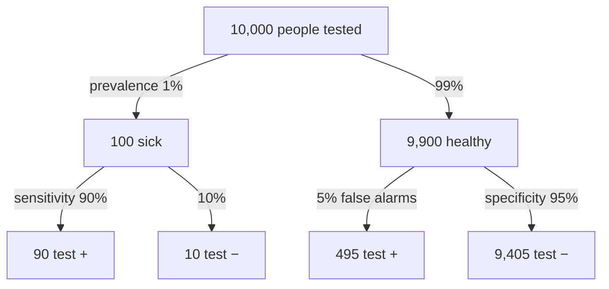

A mammogram has a sensitivity of 0.89 and a specificity of 0.93. How can a positive result mean only about a 4% chance of cancer?

When a condition is rare, healthy people far outnumber sick ones. Even a small false-positive rate, applied to that huge healthy group, produces more false alarms than the test's true hits among the few sick people. So most positives can be false, and the chance of disease after a positive result, called the positive predictive value (PPV), can be low even for a decent test.

![[Positive predictive value - natural frequencies.png|700]]
Top: the sick are a thin sliver of everyone. Bottom: among those who test positive, the false alarms from the huge healthy group outnumber the true positives, so PPV is only about 15%.

Sensitivity and specificity are read down the branches. The positive and negative predictive values (PPV and NPV) are read across the bottom row: PPV = 90 / (90 + 495) ≈ 15%, NPV = 9,405 / (9,405 + 10) ≈ 99.9%. Made-up numbers.

1. Imagine 100,000 women. A prevalence of 0.35% means 350 have cancer and 99,650 don't.
2. A sensitivity of 0.89 means the test catches 311.5 of the 350.
3. A specificity of 0.93 means a 7% false-positive rate: 0.07 × 99,650 ≈ 6,975.5 false positives.
4. That makes about 7,287 positives in total, of which only 311.5 are real.
5. So $P(\text{cancer} \mid +) = 311.5/7{,}287 \approx 0.043$ ([[References|Vu and Harrington 2020, Ch. 2]], pp. 112–116).
6. Change the prevalence and step 1 changes, so the predictive value changes too. Sensitivity and specificity don't.

Confusing $P(+ \mid D)$ with $P(D \mid +)$ would lead patients and doctors to treat positive screening results as near-certain diagnoses. The same mistake happens in testing, when $P(\text{data} \mid H_0)$, the p-value, is confused with $P(H_0 \mid \text{data})$ ([[P-Value]]).

See also: [[Sensitivity and Specificity]], [[Predictive Values and Prevalence]], [[Bayes' Theorem]], [[Contingency Table]], [[Conditional Probability]], [[Ratios and Fractions|denominator]], [[Why probability comes before statistics]], [[Type I and Type II Errors]].
