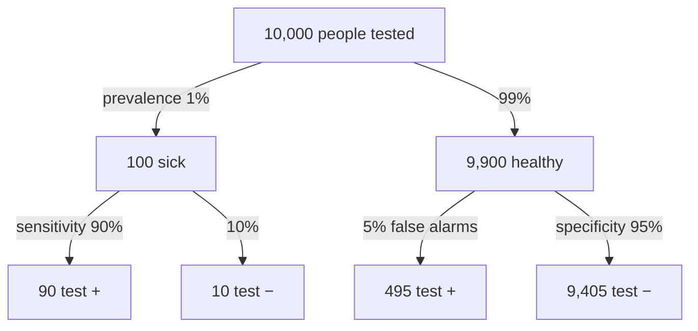

> [!summary] In plain words
> When a condition is rare, healthy people vastly outnumber sick ones. Even a small false-positive rate applied to that huge healthy group produces more false alarms than the test's true hits among the few sick people. So most positives can be false, and the chance of disease after a positive (the PPV) can be low even for a decent test.

## The question
A mammogram has sensitivity 0.89 and specificity 0.93. How can a positive result mean only about a 4% chance of cancer?

## Built from
- [[Sensitivity and Specificity]]: properties of the test.
- [[Predictive Values and Prevalence]]: what a result means for a patient.
- [[Bayes' Theorem]]: how to flip $P(+ \mid D)$ into $P(D \mid +)$.
- [[Contingency Table]]: the hypothetical-population method.
- [[Conditional Probability]]: the "given" changes the [[Ratios and Fractions|denominator]].

## See it

![[Positive predictive value - natural frequencies.png|700]]
*What to look at:* Top: the sick are a thin sliver of everyone. Bottom: among those who test positive, the false alarms from the huge healthy group outnumber the true positives, so PPV is only about 15%.

*What to look at:* sensitivity and specificity are read down the branches. PPV and NPV are read across the bottom row: PPV = 90 / (90 + 495) ≈ 15%, NPV = 9,405 / (9,405 + 10) ≈ 99.9%. Made-up numbers.

## The reasoning, step by step
1. Imagine 100,000 women; prevalence 0.35% means 350 have cancer and 99,650 don't.
2. Sensitivity 0.89: the test catches 311.5 of the 350.
3. Specificity 0.93 means a 7% false-positive rate: 0.07 × 99,650 ≈ 6,975.5 false positives.
4. Total positives ≈ 7,287, of which only 311.5 are real.
5. $P(\text{cancer} \mid +) = 311.5/7{,}287 \approx 0.043$ ([[References|Vu and Harrington 2020, Ch. 2]], pp. 112–116).
6. Change the prevalence and step 1 changes, so the PPV changes; sensitivity and specificity do not.

## What would go wrong otherwise
- Confusing $P(+ \mid D)$ with $P(D \mid +)$ would lead patients and clinicians to treat screening positives as near-certain diagnoses.
- The same mistake in testing: confusing $P(\text{data} \mid H_0)$ (the p-value) with $P(H_0 \mid \text{data})$ ([[P-Value]]).

## Connections
- **Related:** [[Why probability comes before statistics]], [[Type I and Type II Errors]]
- **Part of:** [[MOC - Why We Do It This Way]], [[MOC - Probability]]
