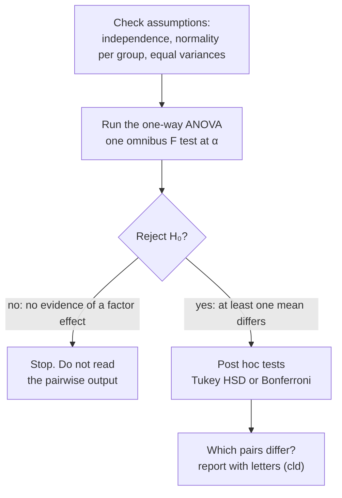

When should you run post hoc tests in a one-way ANOVA?

Only after a significant overall ANOVA. The overall test is the gatekeeper: it asks, at one controlled error rate, whether any difference exists. If it says no, searching through the pairs anyway is exactly the multiple-testing problem ANOVA was meant to avoid. If it says yes, post hoc tests find which means differ, still with adjusted p-values.

The ANOVA is a gate. Pairwise tests only run once the gate opens, which is what keeps the overall [[Type I and Type II Errors|false-positive]] rate at α.

1. $H_0$ says all the means are equal. If you [[Why we never accept the null hypothesis|fail to reject]] it, there is no evidence of any effect of the factor ([[One-Way ANOVA]]).
2. Looking at the pairs anyway means running many tests after the overall test found nothing. That inflates the false-positive rate and amounts to searching the data for something to report ([[Family-Wise Type I Error]]).
3. If you reject, at least one mean differs, but the ANOVA doesn't say which ([[Post Hoc Tests]]).
4. Post hoc tests answer "which", with p-values adjusted for all the comparisons. You can't switch to plain t-tests just because the gate opened ([[Tukey HSD]]).

Otherwise researchers could fail the overall test and then report the one pair that happened to look significant: a false positive dressed up as a finding.

See also: [[Bonferroni Correction]], [[Why a significant ANOVA can have no significant post hocs]], [[Why ANOVA instead of many t-tests]].
