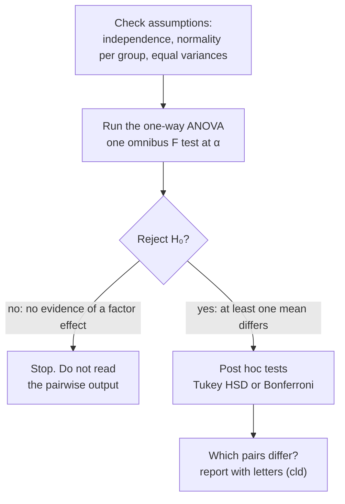

When should you run post hoc tests in a one-way ANOVA?

Only after a significant overall ANOVA. The overall test is the gatekeeper. It asks, at one controlled error rate, whether any difference exists at all. If it says no, searching through the pairs anyway is exactly the multiple-testing problem ANOVA was meant to prevent. If it says yes, post hoc tests find which means differ, still with adjusted p-values.

The ANOVA is a gate. Pairwise tests only run once the gate opens, which is what keeps the overall [[Type I and Type II Errors|false-positive]] rate at α.

Remember why ANOVA exists. Many pairwise tests mean many chances to be fooled. So ANOVA asks one question first, with one controlled risk: is anything going on here?

If the answer is no, you [[Why we never accept the null hypothesis|fail to reject]] $H_0$, the claim that all the means are equal. There's no evidence the factor does anything ([[One-Way ANOVA]]).

Now the temptation. The pairwise output is right there in R, and one pair looks interesting. But reading it now means running many tests after the overall test found nothing. That brings back the inflated false-positive rate, and it amounts to searching the data until something turns up to report ([[Family-Wise Type I Error]]). If you look hard enough at noise, it always says something.

If you do reject, you know at least one mean differs. You don't know which, because the ANOVA doesn't say ([[Post Hoc Tests]]). That's the post hoc test's job: answer "which", with p-values adjusted for all the comparisons. And the gate opening doesn't mean you can switch to plain t-tests. The adjustment still matters ([[Tukey HSD]]).

The order is the whole point. Ask "is there anything?" before "where is it?", and you protect yourself from finding things that aren't there. Skip it, and a failed overall test plus one lucky pair becomes a false positive dressed up as a finding.

See also: [[Bonferroni Correction]], [[Why a significant ANOVA can have no significant post hocs]], [[Why ANOVA instead of many t-tests]].
