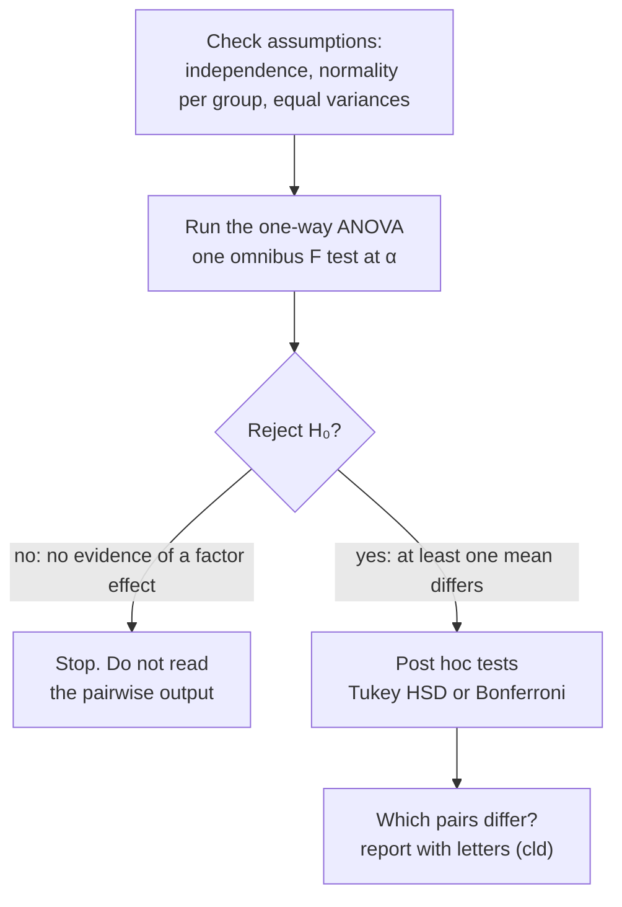

> [!summary] In plain words
> The omnibus ANOVA is the gatekeeper: it asks, at one controlled error rate, whether any difference exists. If it says no, hunting through pairs anyway is exactly the multiple-testing problem ANOVA was meant to avoid. If it says yes, post hocs find which means differ, still with adjusted p-values.

## The question
"When should we perform post hoc tests in a one-way ANOVA?"

## Built from
- [[One-Way ANOVA]]: the omnibus test.
- [[Post Hoc Tests]]: the follow-up.
- [[Family-Wise Type I Error]]: what the gate protects.
- [[Tukey HSD]] and [[Bonferroni Correction]]: the adjusted follow-ups.

## See it

*What to look at:* the ANOVA is a gate. Pairwise tests only run once the gate opens, which is what keeps the overall [[Type I and Type II Errors|false-positive]] rate at α.

## The reasoning, step by step
1. $H_0$: all means equal. [[Why we never accept the null hypothesis|Fail to reject]] → no evidence of any factor effect ([[One-Way ANOVA]]).
2. Looking at pairs anyway means running many tests after the overall test found nothing, which inflates the false-positive rate and amounts to data snooping ([[Family-Wise Type I Error]]).
3. Reject → at least one mean differs, but the ANOVA doesn't say which ([[Post Hoc Tests]]).
4. Post hocs answer "which", with p-values adjusted for all the comparisons; you can't switch to plain t-tests just because the gate opened ([[Tukey HSD]]).

## What would go wrong otherwise
Researchers could fail the omnibus test, then report the one pair that happened to look significant: a false positive dressed up as a finding.

## Connections
- **Related:** [[Why a significant ANOVA can have no significant post hocs]], [[Why ANOVA instead of many t-tests]]
- **Part of:** [[MOC - Why We Do It This Way]], [[MOC - ANOVA]]
