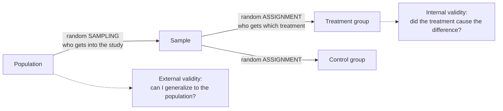

"What's the difference between internal and external validity?" and "random assignment vs random sampling?"

Random assignment decides which treatment each unit gets, which balances hidden differences between groups, so a difference in outcomes can be blamed on the treatment (internal validity). Random sampling decides who gets into the study, which makes the sample look like the population, so results can be generalized (external validity). One does not substitute for the other.

The two random steps happen at different places and buy different things. Sampling protects generalization; assignment protects causation.

1. A difference between [[Treatment and Control Groups|treatment groups]] can come from the treatment or from a nuisance variable tied to group membership ([[Nuisance Variables and Confounding]]).
2. If chance assigns units, no nuisance variable can systematically line up with treatment, so the treatment is the only systematic difference: **internal validity** ([[Random Assignment]]).
3. That says nothing about who was studied. Volunteers, one farm or one lab's mice may differ from the population.
4. If chance picks the units from the population, the sample is representative on average: **external validity** ([[Random Sampling]]).
5. So the four combinations give four strengths of conclusion: both (causal and general), assignment only (causal, for units like these), sampling only (general association), neither (association in this sample) ([[References|Vu and Harrington 2020, Ch. 1]]).

- Claiming causation from a randomly sampled survey would ignore confounding.
- Generalizing a volunteer [[Randomized Controlled Trial|RCT]] to everyone would ignore who volunteers.

See also: [[Internal Validity]], [[Association vs Causation|causation]], [[External Validity]], [[Why RCTs trade external validity for internal validity]], [[Experiment]], [[Quasi-Experiment]].
