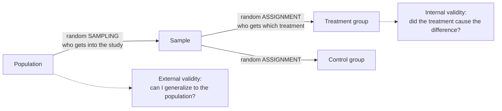

What is the difference between internal and external validity, and between random assignment and random sampling?

Random assignment decides which treatment each unit gets. It balances hidden differences between the groups, so a difference in outcomes can be credited to the treatment. That's internal validity: "did it cause it?" Random sampling decides who gets into the study. It makes the sample resemble the population, so the results can be generalized. That's external validity: "does it hold out there?" They're two different coin flips doing two different jobs, and one can't stand in for the other.

The two random steps happen at different places and buy different things. Sampling protects generalization. Assignment protects causation.

These two get confused constantly, because both involve "randomness". So separate them by asking what problem each one solves.

**The causation problem.** Suppose the treatment group does better. Maybe the treatment worked. Or maybe something else was tied to which group a unit landed in, healthier people, a better field, a keener technician ([[Nuisance Variables and Confounding]]). You can't list every such thing, let alone balance them all by hand. So you let chance assign the units. Then no nuisance variable can line up with the treatment systematically, and the treatment is the only systematic difference left. That gives **internal validity** ([[Random Assignment]]).

But notice what assignment says nothing about: who was in the study. Volunteers, one farm, or one lab's mice may be quite different from the population you care about.

**The generalization problem.** That's what random sampling solves. If chance picks the units from the population, the sample is representative on average. That gives **external validity** ([[Random Sampling]]).

Two problems, two tools, so four combinations, each earning a different strength of conclusion. Both: causal and general. Assignment only: causal, but for units like these. Sampling only: an association that generalizes. Neither: an association in this sample only ([[References|Vu and Harrington 2020, Ch. 1]]).

Once you see the two jobs, a lot of bad reasoning becomes easy to spot. Claiming causation from a randomly sampled survey ignores confounding. Applying a [[Randomized Controlled Trial|randomized trial]] run on volunteers to everyone ignores who volunteers. Before you trust a conclusion, ask which coin was flipped, and where.

See also: [[Internal Validity]], [[Association vs Causation|causation]], [[External Validity]], [[Why RCTs trade external validity for internal validity]], [[Experiment]], [[Quasi-Experiment]].
