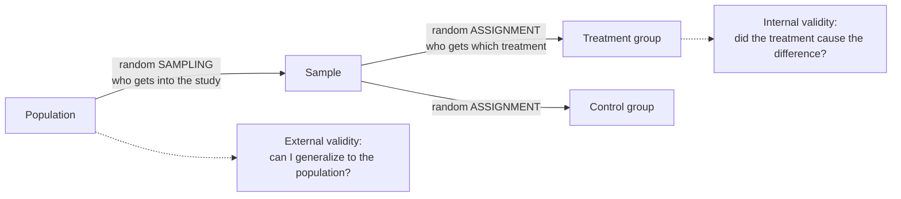

What is the difference between internal and external validity, and between random assignment and random sampling?

Random assignment decides which treatment each unit gets. That balances hidden differences between the groups, so a difference in outcomes can be credited to the treatment. This is internal validity. Random sampling decides who gets into the study. That makes the sample resemble the population, so results can be generalized. This is external validity. One can't stand in for the other.

The two random steps happen at different places and buy different things. Sampling protects generalization; assignment protects causation.

1. A difference between [[Treatment and Control Groups|treatment groups]] can come from the treatment, or from a nuisance variable tied to which group a unit is in ([[Nuisance Variables and Confounding]]).
2. If chance assigns the units, no nuisance variable can line up with the treatment systematically, so the treatment is the only systematic difference. That gives **internal validity** ([[Random Assignment]]).
3. That says nothing about who was studied. Volunteers, one farm or one lab's mice may differ from the population.
4. If chance picks the units from the population, the sample is representative on average. That gives **external validity** ([[Random Sampling]]).
5. So the four combinations give four strengths of conclusion: both (causal and general), assignment only (causal, for units like these), sampling only (an association that generalizes), and neither (an association in this sample only) ([[References|Vu and Harrington 2020, Ch. 1]]).

Claiming causation from a randomly sampled survey would ignore confounding. And applying a [[Randomized Controlled Trial|randomized trial]] run on volunteers to everyone would ignore who volunteers.

See also: [[Internal Validity]], [[Association vs Causation|causation]], [[External Validity]], [[Why RCTs trade external validity for internal validity]], [[Experiment]], [[Quasi-Experiment]].
