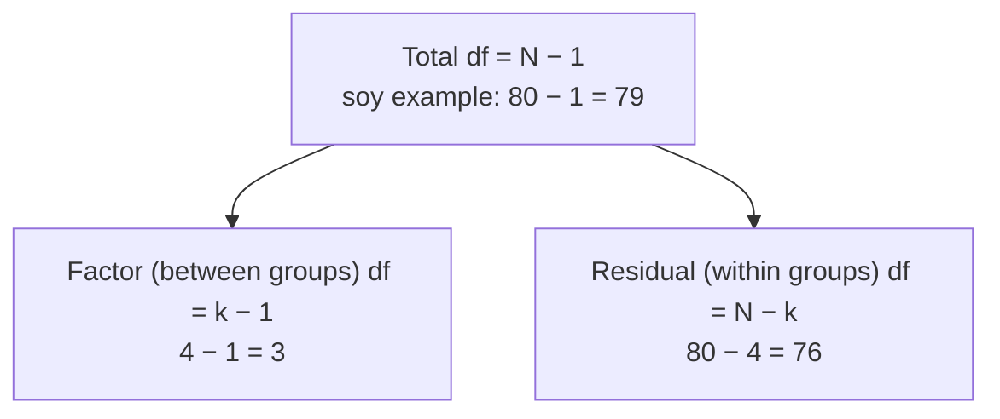

Why is checking the degrees of freedom such good advice?

The degrees of freedom (df) in R's output are fixed by your [[Sample Size|sample size]] and the number of groups, which you already know. If they don't match what you expect, something went wrong before the test: rows were silently dropped because of missing data, or a group variable was read as a number. Checking the df takes seconds and catches errors the p-value never would.

The two rows of the ANOVA table split the total df (and the total [[Sums of Squares and Mean Squares|sum of squares]]) between them, so 3 + 76 = 79. If R prints anything else, check the data.

1. Every test's df come from $n$ and the number of estimated quantities: $n - 1$, $n_1 + n_2 - 2$, $k - 1$ and $N - k$ ([[Degrees of Freedom]]).
2. Before running a test, you know $n$ and $k$, so you can predict the df.
3. **Fewer df than expected** means rows were dropped. In a COVID survey, the expected df was 999 but R showed 938, so 61 rows were lost to missing values ([[Missing Data]]).
4. **An ANOVA [[Ratios and Fractions|numerator]] df of 1 with 4 treatments** means R treated the treatment codes as one number ([[factor()]]).
5. **Check the sign too.** A t statistic is negative exactly when $\bar{x}$ is below $\mu_0$ (or the first group is lower). For body temperature, $\bar{x}$ = 98.249 is below 98.6, so t = −5.45 must be negative ([[Test Statistic]]).
6. **The ANOVA df tell you the design.** df of 2 and 12 mean 3 groups and 15 observations; 3 and 76 mean 4 groups and 80 people ([[ANOVA Table]]).

Otherwise an analysis could run on the wrong data or the wrong model with no error message, and the p-value would look perfectly normal.

See also: [[str()]], [[Why check assumptions before trusting a test]].
