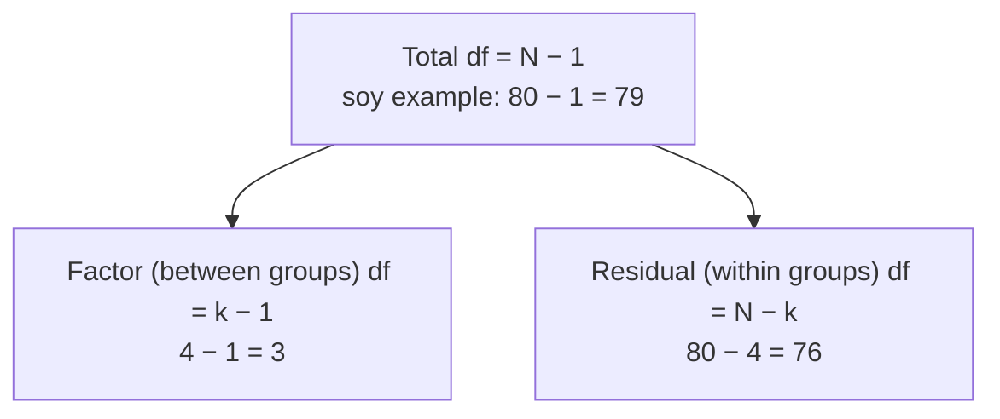

Why is checking the degrees of freedom such good advice?

Because the degrees of freedom (df) are one of the few numbers in the output you can predict before you run anything, and anything you can predict, you can check. They're fixed by your [[Sample Size|sample size]] and the number of groups, which you already know. If they don't match what you expect, something went wrong before the test: rows were silently dropped because of missing data, or a group variable was read as a number. Checking takes seconds and catches errors the p-value never would.

The two rows of the ANOVA table split the total df (and the total [[Sums of Squares and Mean Squares|sum of squares]]) between them, so 3 + 76 = 79. If R prints anything else, check the data.

Here's the problem with statistical software. It never complains when you ask the wrong question. It runs, prints a tidy table, and gives you a p-value that looks perfectly normal. So you need a way to check, from the outside, that it analysed what you think it analysed.

The degrees of freedom are that check. Every test's df come from $n$ and the number of quantities it estimated: $n - 1$, $n_1 + n_2 - 2$, $k - 1$ and $N - k$ ([[Degrees of Freedom]]). Before you run the test, you know $n$ and $k$. So you can write down the df in advance, and compare.

When they don't match, they tell you what went wrong.

**Fewer df than expected** means rows were dropped. In a COVID survey, the expected df was 999 but R showed 938, so 61 rows had been quietly lost to missing values ([[Missing Data]]).

**An ANOVA [[Ratios and Fractions|numerator]] df of 1 with 4 treatments** means R treated the treatment codes as one number, fitting a line instead of four means ([[factor()]]).

The same habit works for other numbers you can predict. **Check the sign too.** A t statistic is negative exactly when $\bar{x}$ is below $\mu_0$, or the first group is lower. For body temperature, $\bar{x}$ = 98.249 is below 98.6, so t = −5.45 must be negative ([[Test Statistic]]).

And it works in reverse. **The ANOVA df tell you the design.** df of 2 and 12 mean 3 groups and 15 observations. 3 and 76 mean 4 groups and 80 people ([[ANOVA Table]]). If you're handed someone else's output, the df tell you what they actually ran.

The deeper habit is this: before you look at an answer, know roughly what it should look like. Then surprises become signals. Without that, an analysis can run on the wrong data or the wrong model with no error message, and the p-value will look perfectly normal.

See also: [[str()]], [[Why check assumptions before trusting a test]].
