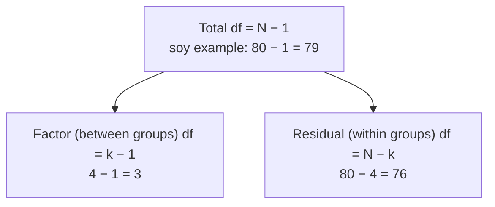

> [!summary] In plain words
> The degrees of freedom in R's output are fixed by your [[Sample Size|sample size]] and number of groups, which you already know. If they don't match what you expect, something went wrong before the test: rows were silently dropped for missing data, or a group variable was read as a number. Checking df takes seconds and catches errors the p-value never would.

## The question
Why is "use df as a sanity check" such good advice?

## Built from
- [[Degrees of Freedom]]: the formulas.
- [[Missing Data]]: silent row loss.
- [[factor()]]: numeric codes vs categories.
- [[ANOVA Table]]: where ANOVA df appear.

## See it

*What to look at:* the two rows of the ANOVA table split the total df (and the total [[Sums of Squares and Mean Squares|sum of squares]]) between them, so 3 + 76 = 79. If R prints anything else, check the data.

## The reasoning, step by step
1. Every test's df comes from $n$ and the number of estimated quantities: $n - 1$, $n_1 + n_2 - 2$, $k - 1$ and $N - k$ ([[Degrees of Freedom]]).
2. Before running a test, I know $n$ and $k$, so I can predict the df.
3. **df smaller than expected** → rows were dropped. COVID: expected 999, saw 938 → 61 rows lost to NAs ([[Missing Data]]).
4. **ANOVA [[Ratios and Fractions|numerator]] df = 1 with 4 treatments** → R treated the treatment codes as one number ([[factor()]]).
5. **Check the sign too:** a t statistic is negative exactly when $\bar{x}$ is below $\mu_0$ (or the first group is lower). Body temperature: $\bar{x}$ = 98.249 < 98.6, so t = −5.45 must be negative ([[Test Statistic]]).
6. **ANOVA df tell you the design:** 2 and 12 → 3 groups and 15 observations; 3 and 76 → 4 groups and 80 people ([[ANOVA Table]]).

## What would go wrong otherwise
An analysis could run on the wrong data or the wrong model with no error message, and the p-value would look perfectly normal.

## Connections
- **Related:** [[str()]], [[Why check assumptions before trusting a test]]
- **Part of:** [[MOC - Why We Do It This Way]], [[MOC - Inference Foundations]], [[MOC - ANOVA]]
