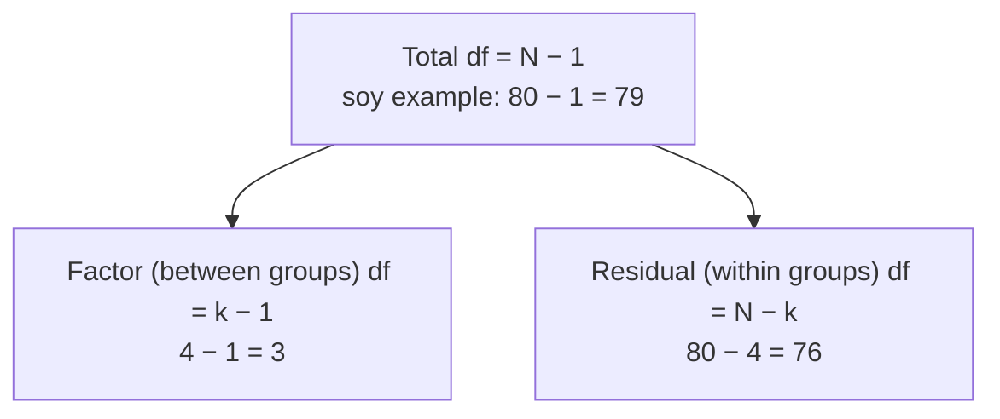

The ANOVA table is a summary of the whole ANOVA in one grid: for the groups and for the leftover noise, it shows the degrees of freedom (df), sums of squares, mean squares, F and the p-value. The numbers fit together like a puzzle, so you can check each one against the others.

The table looks scary, but it's just a story told left to right. ANOVA splits all the variation into "between groups" and "within groups" ([[Sums of Squares and Mean Squares]], [[Variability]]). Each gets a row. Then, moving across: how much variation (SS), how many independent pieces it's made of (df), the average per piece (MS = SS/df), and finally the comparison (F) and how surprising it is (p).

| Source | df | SS | MS = SS/df | F | p |
|---|---|---|---|---|---|
| **Between** (factor, group, treatment, or the variable's name) | $k - 1$ | $SSG = \sum n_i(\bar{x}_i - \bar{x})^2$ | $MSG$ | $MSG/MSE$ | upper tail |
| **Within** (error, residuals) | $N - k$ | $SSE = \sum\sum(x_{ij} - \bar{x}_i)^2$ | $MSE$ | | |
| **Total** (often not printed) | $N - 1$ | $SST = SSG + SSE$ | | | |

Here $\bar{x}$ is the [[Grand Mean|grand mean]] and $\bar{x}_i$ is the mean of group $i$. Squares, as always, so distances above and below don't cancel ([[Variance]]). And each SS is divided by its df before comparing, because a sum grows just from having more pieces ([[Degrees of Freedom]]).

Now, why is it like a puzzle? Because the columns check each other:
- The df add up: between plus within equals total.
- The sums of squares add up the same way.
- Each MS is its SS divided by its df.
- F is the between MS over the within MS.

So if someone hides a few numbers, you can rebuild them. And the df tell you about the study: between df plus 1 is the number of groups; total df plus 1 is the number of observations R actually used ([[Why use degrees of freedom as a sanity check]]). Bonus: $SSG/SST$ is η², the effect size, the share of all the variation the groups explain ([[Effect Size]]).


The two rows of the ANOVA table split the total df (and the total sum of squares) between them, so 3 + 76 = 79. If R prints anything else, check the data.

For example, here is the book's FAMuSS output from R ([[References|Vu and Harrington 2020, Ch. 5]], p. 269):
```
                    Df Sum Sq Mean Sq F value Pr(>F)
famuss$actn3.r577x   2   7043    3522   3.231 0.0402
Residuals          592 645293    1090
```
Check: 7043/2 ≈ 3522; 645293/592 ≈ 1090; 3522/1090 ≈ 3.23. A df of 2 means 3 genotypes, and 2 + 592 + 1 = 595 participants.

Try it yourself. An ANOVA table shows df of 2 and 7. How many groups, and how many observations? 2 + 1 = 3 groups, and 2 + 7 + 1 = 10 observations. And the "Residuals" row? Not mistakes, just the variation left over inside the groups after the group means are accounted for ([[Residuals|residuals]]).

See also: [[Between- and Within-Group Variability]], [[F-Distribution]], [[aov()]], [[Tails of a Distribution]], [[One-Way ANOVA|ANOVA]].

Further reading: [[References|Vu and Harrington 2020, Ch. 5]] (p. 269).
