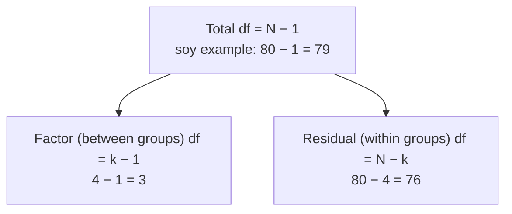

The [[One-Way ANOVA|ANOVA]] table lists, for the factor and for the [[Residuals|residuals]], the degrees of freedom (df), sums of squares, mean squares, the F ratio and the p-value. The numbers fit together like a puzzle, so each one can be checked against the others.

The ANOVA table looks intimidating, but it's just one idea written out in columns. ANOVA splits the total [[Variability|variation]] into a between-groups part and a within-groups part ([[Sums of Squares and Mean Squares]]). The table lays out that split with one row per source, building from left to right: the sum of squares (SS, how much variation), the df (how many independent pieces), the mean square MS = SS/df (a variance), and then F and p.

| Source | df | SS | MS = SS/df | F | p |
|---|---|---|---|---|---|
| **Between** (factor, group, treatment, or the variable's name) | $k - 1$ | $SSG = \sum n_i(\bar{x}_i - \bar{x})^2$ | $MSG$ | $MSG/MSE$ | upper tail |
| **Within** (error, residuals) | $N - k$ | $SSE = \sum\sum(x_{ij} - \bar{x}_i)^2$ | $MSE$ | | |
| **Total** (often not printed) | $N - 1$ | $SST = SSG + SSE$ | | | |

Here $\bar{x}$ is the [[Grand Mean|grand mean]] and $\bar{x}_i$ is the mean of group $i$. Deviations are squared for the same reason as in the variance ([[Variance]]). Each sum of squares is divided by its df because a sum of squares grows with the number of terms, so it has to be averaged before two of them can be compared ([[Degrees of Freedom]]).

The columns check each other. The df and the sums of squares each add up to the total, and $N - 1$ should match the number of rows R used ([[Why use degrees of freedom as a sanity check]]). $SSG/SST$ is η², the effect size ([[Effect Size]]).


The two rows of the ANOVA table split the total df (and the total sum of squares) between them, so 3 + 76 = 79. If R prints anything else, check the data.

The table organizes the whole calculation, and it's the place to run quick checks. Software works it out for you, so your job is to read it, and to notice when a number doesn't fit.

For example, here is the book's FAMuSS output from R ([[References|Vu and Harrington 2020, Ch. 5]], p. 269):
```
                    Df Sum Sq Mean Sq F value Pr(>F)
famuss$actn3.r577x   2   7043    3522   3.231 0.0402
Residuals          592 645293    1090
```
Check: 7043/2 ≈ 3522; 645293/592 ≈ 1090; 3522/1090 ≈ 3.23. A df of 2 means 3 genotypes, and 2 + 592 + 1 = 595 participants.

"Residuals" doesn't mean mistakes. It means the within-group variability left over after the group means are accounted for.

See also: [[Between- and Within-Group Variability]], [[F-Distribution]], [[aov()]], [[Tails of a Distribution]].

Further reading: [[References|Vu and Harrington 2020, Ch. 5]] (p. 269).
