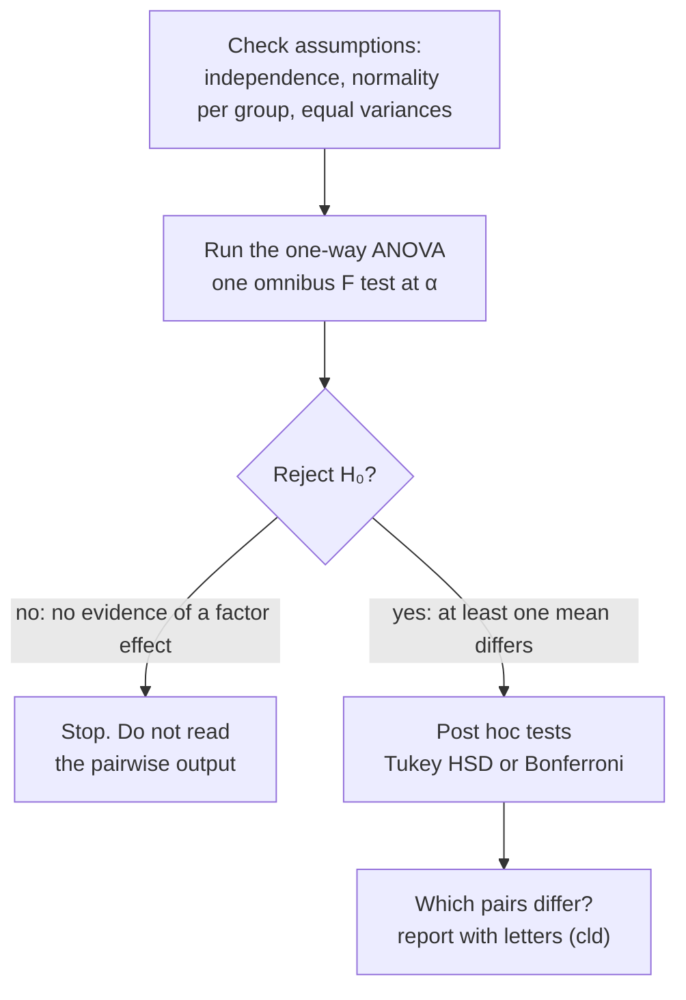

**In one line:** one-way ANOVA tests whether the means of three or more independent groups are all equal, in a single omnibus test that compares variability between groups with variability within them.

> [!info] Before this, it helps to know
> [[Two-Sample Independent t-Test]] (what it extends) · [[Factors and Levels]] (one factor, k levels) · [[Statistical Model]] (what it fits) · [[Between- and Within-Group Variability]] (how it decides)

## Start from zero
1. **One [[Types of Data|quantitative]] response, one categorical factor with $k$ levels** ([[Factors and Levels]]). It moves "on up" from the two-sample t-test (as in *The Jeffersons*) ([[Two-Sample Independent t-Test]]).
2. **Running a t-test for every pair inflates [[Type I and Type II Errors|false positives]],** so we need one test for all the means at once ([[Family-Wise Type I Error]], [[Why ANOVA instead of many t-tests]]).
3. **[[Null and Alternative Hypotheses|Hypotheses]]**
   - $H_0: \mu_1 = \mu_2 = \cdots = \mu_k$. In words: **no [factor] effect on the mean [response]**.
   - $H_A$: **at least one population mean differs**. In words: **a significant [factor] effect on the mean [response]**.
   - ❌ Not $\mu_1 \ne \mu_2 \ne \cdots \ne \mu_k$: you need only *some break in the chain*.
4. **Model each value as its group mean plus an error** ([[Statistical Model]], [[Residuals]]). Splitting the total [[Variability|variation]] into "between groups" and "within groups" gives two variance estimates ([[Sums of Squares and Mean Squares]]).
5. **The [[Parameter vs Statistic|statistic]]:** $F = MSG/MSE$, between-group over within-group variability ([[Between- and Within-Group Variability]], [[F-Distribution]]). *Why it works:* under $H_0$ both [[Point Estimate|estimate]] the same noise, so F ≈ 1; a large F says the group means are further apart than noise explains.
6. **A significant F says "some means differ", not which.** Post hoc tests answer that ([[Post Hoc Tests]]).

## See it

![[Between vs within variability.png|700]]
*What to look at:* The group means (black bars) are identical in both panels. On the left the points are tight, so the gaps between means stand out; on the right the same gaps are buried in noise. ANOVA's F is exactly this between-versus-within comparison.


*What to look at:* the ANOVA is a gate. Pairwise tests only run once the gate opens, which is what keeps the overall false-positive rate at α.

## Why it exists
Running a t-test for every pair of groups multiplies the chance of a false positive ([[Why ANOVA instead of many t-tests]]). ANOVA asks the overall question once, as a "gatekeeper".

## A tiny example
The workflow:
1. **[[Exploratory Data Analysis|Explore]]:** descriptives by group; [[Box Plot and Five-Number Summary|box plots]] **with mean markers**; group SDs as a first equal-variance screen.
2. **Check [[Test Assumptions|requirements]]:** independence, [[Normality Checks|normality]], equal variances ([[ANOVA Assumptions]]).
3. **Omnibus test:** `aov(y ~ factor)` then `summary()` ([[aov()]]).
4. **p > α → stop.** No evidence of a factor effect. Don't read post hocs, even if printed.
5. **p ≤ α → post hoc tests** to find which means differ ([[Post Hoc Tests]]).
6. **Report** in APA style, e.g. *F*(3, 116) = ..., *p* < .001, then the post hocs ([[Writing a Conclusion]]).

## How to run it

![[Worked example - one-way ANOVA.png|700]]
*What to look at:* left, the three means rise from CC to TT, and only CC and TT have no letter in common. Right, F = 3.23 sits in the upper [[Tails of a Distribution|tail]] of the F(2, 592) curve; the shaded area is the p-value.

**Worked example: ACTN3 genotype and arm strength** (FAMuSS, [[References|Vu and Harrington 2020, Ch. 5]], pp. 264–271). 595 adults trained their non-dominant arm; the response is the % change in its strength (`ndrm.ch`), and the factor is genotype at one spot on the ACTN3 gene (CC, CT, TT). The data are in `Data/famuss.csv` (the book's `famuss` data, two columns).

| genotype | n | mean | [[Standard Deviation\|SD]] |
|---|---|---|---|
| CC | 173 | 48.89 | 29.96 |
| CT | 261 | 53.25 | 33.23 |
| TT | 161 | 58.08 | 35.69 |

[[Grand Mean|Grand mean]] $\bar{x}$ = 53.29, N = 595, k = 3.

1. **Pick the test.** One quantitative response, one factor with 3 levels, independent people: one-way ANOVA ([[Test Choice Guide]]). Not three t-tests ([[Why ANOVA instead of many t-tests]]).

2. **Hypotheses and α.** $H_0: \mu_{CC} = \mu_{CT} = \mu_{TT}$ (no genotype effect on mean strength change); $H_A$: at least one mean differs. α = 0.05. *Why "at least one":* a single break in the chain of equalities is enough to make $H_0$ false.

3. **Check the requirements** ([[ANOVA Assumptions]]).
   - Independence: unrelated participants. *Why:* related people (relatives, [[Independent vs Paired Samples|repeated measures]]) would share variation the model treats as independent.
   - Normality per group: Shapiro p < 0.001 in all three groups (moderate [[Shape of a Distribution|right skew]]). With 161 to 261 per group the CLT helps, so proceed with caution and check with a rank-based test. *Why the CLT helps:* F compares means, and means of 161+ values are close to normal even when the values aren't ([[Robustness]], [[Central Limit Theorem]]).
   - Equal variances: SDs 29.96 to 35.69, a largest/smallest variance [[Ratios and Fractions|ratio]] of 1.42, far under 9:1. Levene: F(2, 592) = 1.03, p = 0.36. *Why it matters:* MSE pools the three spreads into one, which only makes sense if they are similar ([[Homogeneity of Variance]]).

4. **Calculate by hand** (formula sheet).
   - *Why these two pieces:* each value's distance from the grand mean splits into its group mean's distance ([[Signal and Noise|signal]]) plus its distance from its group mean (noise) ([[Sums of Squares and Mean Squares]], [[Statistical Model]]).
   - SSG = 173(48.89 − 53.29)² + 261(53.25 − 53.29)² + 161(58.08 − 53.29)² ≈ 7043, so MSG = 7043/(3 − 1) ≈ **3522**
   - SSE = 172(29.96²) + 260(33.23²) + 160(35.69²) ≈ 645,293 (*why $(n_i - 1)s_i^2$:* that is each group's sum of squared residuals: [[Residuals]]), so MSE = 645,293/(595 − 3) ≈ **1090**
   - F = 3522/1090 = **3.23** with df **2 and 592**; the upper tail gives p ≈ 0.04. *Why divide by df first:* SSE adds up 592 independent pieces and SSG only 2, so each must be averaged before comparing. *Why only the upper tail:* differences between means can only push F up ([[F-Distribution]]). F is past the critical value 3.01, which agrees ([[Critical Value]]).
   - η² = SSG/SST = 7043/(7043 + 645,293) = **0.011**: genotype explains about 1% of the variability ([[Effect Size]]).

5. **Run it in R.**
```r
famuss <- read.csv(file.choose())                       # Data/famuss.csv
famuss$genotype <- factor(famuss$genotype)              # CC, CT, TT
aggregate(ndrm.ch ~ genotype, data = famuss, FUN = sd)  # 29.96, 33.23, 35.69
by(famuss$ndrm.ch, famuss$genotype, shapiro.test)       # all p < 0.001
car::leveneTest(ndrm.ch ~ genotype, data = famuss)      # F = 1.03, p = 0.36
famuss.aov <- aov(ndrm.ch ~ genotype, data = famuss)
summary(famuss.aov)
#              Df Sum Sq Mean Sq F value Pr(>F)
# genotype      2   7043    3522   3.231 0.0402 *
# Residuals   592 645293    1090
TukeyHSD(famuss.aov)
#        diff    lwr    upr  p adj
# CT-CC  4.35  -3.25  11.96  0.371
# TT-CC  9.19   0.69  17.68  0.030
# TT-CT  4.83  -2.94  12.61  0.310
pairwise.t.test(famuss$ndrm.ch, famuss$genotype, p.adjust.method = "bonferroni")
# CT vs CC 0.537, TT vs CC 0.034, TT vs CT 0.433
kruskal.test(ndrm.ch ~ genotype, data = famuss)         # chi-squared = 5.75, df = 2, p = 0.057
```
   Sanity-check the df: 2 = 3 groups − 1, 592 = 595 − 3 ([[Why use degrees of freedom as a sanity check]]).

6. **Decide and report.** p = 0.040 ≤ 0.05, so the gate opens and post hocs are allowed ([[Why post hoc tests only after a significant ANOVA]]). *Why post hocs at all:* F says some mean differs, not which. *Why adjusted ones:* three comparisons at 0.05 each would inflate false positives ([[Family-Wise Type I Error]]). [[Tukey HSD|Tukey]] and [[Bonferroni Correction|Bonferroni]] agree: only TT vs CC differs. Letters: CC **a**, CT **ab**, TT **b** ([[Compact Letter Display]]).
   > A one-way ANOVA showed a significant effect of ACTN3 genotype on percent change in non-dominant arm strength, *F*(2, 592) = 3.23, *p* = .040, η² = .011. Tukey's HSD showed that TT (*M* = 58.08) gained more than CC (*M* = 48.89), difference 9.19, 95% [[Confidence Interval|CI]] [0.69, 17.68], *p* = .030; CT did not differ from either.

   **The honest caveat:** normality was violated and the Kruskal–Wallis check (p = 0.057) does not confirm the result at 0.05, and η² says the effect is small. Report the result, but as borderline.

## Common confusions
- **"Reject $H_0$ means all groups differ."** At least one differs.
- **"ANOVA compares variances, so it tests variances."** It uses variances to test means ([[Why analysis of variance can compare means]]).

## Connections
- **Builds on:** [[Two-Sample Independent t-Test]], [[Factors and Levels]], [[Variance]], [[Statistical Model]], [[Between- and Within-Group Variability]]
- **Leads to:** [[ANOVA Table]], [[ANOVA Assumptions]], [[Post Hoc Tests]], [[aov()]]
- **Part of:** [[MOC - ANOVA]]
- **Go deeper:** [[References|Vu and Harrington 2020, Ch. 5]] (§5.5, p. 264)
- **Terms used:** [[Chi-Square Test]], [[wilcox.test() and kruskal.test()]]
