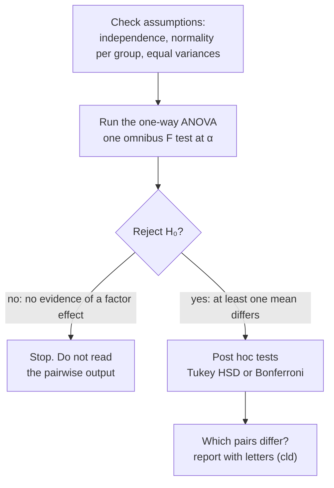

One-way ANOVA tests whether the means of three or more independent groups are all equal. It does this in a single overall test that compares the variability between the groups with the variability within them.

The real question is simple: do these groups differ, or are we looking at noise? There is one [[Types of Data|quantitative]] response and one categorical factor with $k$ levels ([[Factors and Levels]]). It is the next step up from the two-sample t-test ([[Two-Sample Independent t-Test]]). Running a t-test for every pair of groups would multiply the chance of [[Type I and Type II Errors|false positives]], so we need one test for all the means at once ([[Family-Wise Type I Error]], [[Why ANOVA instead of many t-tests]]).

The [[Null and Alternative Hypotheses|hypotheses]]:
- $H_0: \mu_1 = \mu_2 = \cdots = \mu_k$. In words: **the [factor] has no effect on the mean [response]**.
- $H_A$: **at least one population mean differs**. In words: **the [factor] has a significant effect on the mean [response]**.

Don't write $H_A$ as $\mu_1 \ne \mu_2 \ne \cdots \ne \mu_k$. One break anywhere in the chain of equalities is enough.

Here's the clever part. ANOVA models each value as its group mean plus an error ([[Statistical Model]], [[Residuals]]). Splitting the total [[Variability|variation]] into "between groups" and "within groups" gives two variance estimates ([[Sums of Squares and Mean Squares]]). The [[Parameter vs Statistic|statistic]] is $F = MSG/MSE$: the mean square between groups over the mean square within groups ([[Between- and Within-Group Variability]], [[F-Distribution]]). If $H_0$ is true, both [[Point Estimate|estimate]] the same noise, so F is near 1. A large F says the group means are further apart than noise explains.

Notice what this buys you: one question, one answer, one α. A significant F says that some means differ, but not which ones. Post hoc tests answer that ([[Post Hoc Tests]]).

![[Between vs within variability.png|700]]
The group means (black bars) are identical in both panels. On the left the points are tight, so the gaps between means stand out; on the right the same gaps are buried in noise. ANOVA's F is exactly this between-versus-within comparison.


The ANOVA is a gate. Pairwise tests only run once the gate opens, which is what keeps the overall false-positive rate at α.

The usual workflow:
1. **[[Exploratory Data Analysis|Explore]]:** summaries by group, [[Box Plot and Five-Number Summary|box plots]] **with the means marked**, and the group standard deviations (SD) as a first check of equal variances.
2. **Check the [[Test Assumptions|requirements]]:** independence, [[Normality Checks|normality]] and equal variances ([[ANOVA Assumptions]]).
3. **Run the overall test:** `aov(y ~ factor)`, then `summary()` ([[aov()]]).
4. **If p > α, stop.** There is no evidence of a factor effect. Don't read post hoc tests, even if they are printed.
5. **If p ≤ α, run post hoc tests** to find which means differ ([[Post Hoc Tests]]).
6. **Report** in the style of the American Psychological Association (APA), for example *F*(3, 116) = ..., *p* < .001, followed by the post hoc results ([[Writing a Conclusion]]).

![[Worked example - one-way ANOVA.png|700]]
Left, the three means rise from CC to TT, and only CC and TT have no letter in common. Right, F = 3.23 sits in the upper [[Tails of a Distribution|tail]] of the F(2, 592) curve; the shaded area is the p-value.

**Worked example: ACTN3 genotype and arm strength** (FAMuSS, [[References|Vu and Harrington 2020, Ch. 5]], pp. 264–271). 595 adults trained their non-dominant arm. The response is the % change in its strength (`ndrm.ch`), and the factor is genotype at one spot on the ACTN3 gene (CC, CT, TT). The data are in `Data/famuss.csv` (the book's `famuss` data, two columns).

| genotype | n | mean | [[Standard Deviation\|SD]] |
|---|---|---|---|
| CC | 173 | 48.89 | 29.96 |
| CT | 261 | 53.25 | 33.23 |
| TT | 161 | 58.08 | 35.69 |

[[Grand Mean|Grand mean]] $\bar{x}$ = 53.29, N = 595, k = 3.

1. **Pick the test.** One quantitative response, one factor with 3 levels and independent people call for a one-way ANOVA, not three t-tests ([[Test Choice Guide]]).

2. **Hypotheses and α.** $H_0: \mu_{CC} = \mu_{CT} = \mu_{TT}$ (genotype has no effect on the mean strength change); $H_A$: at least one mean differs. α = 0.05.

3. **Check the requirements** ([[ANOVA Assumptions]]).
   - Independence: the participants are unrelated. Related people, such as relatives or [[Independent vs Paired Samples|repeated measures]] on one person, would share variation that the model treats as independent.
   - Normality in each group: the Shapiro p is below 0.001 in all three groups, because of moderate [[Shape of a Distribution|right skew]]. With 161 to 261 people per group, the central limit theorem helps, so go ahead with caution and check with a rank-based test. It helps because F compares means, and means of 161 or more values are close to normal even when the values aren't ([[Robustness]], [[Central Limit Theorem]]).
   - Equal variances: the SDs run from 29.96 to 35.69, a largest-to-smallest variance [[Ratios and Fractions|ratio]] of 1.42, far under 9:1. Levene's test gives F(2, 592) = 1.03, p = 0.36. This matters because the within-group mean square pools the three spreads into one, which only makes sense if they are similar ([[Homogeneity of Variance]]).

4. **Calculate by hand.** Each value's distance from the grand mean splits into its group mean's distance from the grand mean (the [[Signal and Noise|signal]]) plus its distance from its own group mean (the noise) ([[Sums of Squares and Mean Squares]], [[Statistical Model]]).
   - The between-group sum of squares is SSG = 173(48.89 − 53.29)² + 261(53.25 − 53.29)² + 161(58.08 − 53.29)² ≈ 7043, so MSG = 7043/(3 − 1) ≈ **3522**.
   - The within-group sum of squares is SSE = 172(29.96²) + 260(33.23²) + 160(35.69²) ≈ 645,293, because $(n_i - 1)s_i^2$ is each group's sum of squared residuals ([[Residuals]]). So MSE = 645,293/(595 − 3) ≈ **1090**.
   - F = 3522/1090 = **3.23**, with degrees of freedom **2 and 592**, and the upper tail gives p ≈ 0.04. Each sum of squares is divided by its degrees of freedom first because SSE adds up 592 independent pieces and SSG only 2. Only the upper tail counts because differences between means can only push F up ([[F-Distribution]]). F is past the critical value 3.01, which agrees ([[Critical Value]]).
   - η² = SSG/SST = 7043/(7043 + 645,293) = **0.011**: genotype explains about 1% of the variability ([[Effect Size]]).

5. **Run it in R.**
```r
famuss <- read.csv(file.choose())                       # Data/famuss.csv
famuss$genotype <- factor(famuss$genotype)              # CC, CT, TT
aggregate(ndrm.ch ~ genotype, data = famuss, FUN = sd)  # 29.96, 33.23, 35.69
by(famuss$ndrm.ch, famuss$genotype, shapiro.test)       # all p < 0.001
car::leveneTest(ndrm.ch ~ genotype, data = famuss)      # F = 1.03, p = 0.36
famuss.aov <- aov(ndrm.ch ~ genotype, data = famuss)
summary(famuss.aov)
#              Df Sum Sq Mean Sq F value Pr(>F)
# genotype      2   7043    3522   3.231 0.0402 *
# Residuals   592 645293    1090
TukeyHSD(famuss.aov)
#        diff    lwr    upr  p adj
# CT-CC  4.35  -3.25  11.96  0.371
# TT-CC  9.19   0.69  17.68  0.030
# TT-CT  4.83  -2.94  12.61  0.310
pairwise.t.test(famuss$ndrm.ch, famuss$genotype, p.adjust.method = "bonferroni")
# CT vs CC 0.537, TT vs CC 0.034, TT vs CT 0.433
kruskal.test(ndrm.ch ~ genotype, data = famuss)         # chi-squared = 5.75, df = 2, p = 0.057
```
   Check the degrees of freedom: 2 = 3 groups − 1, and 592 = 595 − 3 ([[Why use degrees of freedom as a sanity check]]).

6. **Decide and report.** p = 0.040 ≤ 0.05, so the gate opens and post hoc tests are allowed ([[Why post hoc tests only after a significant ANOVA]]). They are needed because F says some mean differs, but not which. They must be adjusted because three comparisons at 0.05 each would inflate false positives. [[Tukey HSD|Tukey's honestly significant difference (HSD) test]] and the [[Bonferroni Correction|Bonferroni correction]] agree: only TT and CC differ. The letters are CC **a**, CT **ab**, TT **b** ([[Compact Letter Display]]).
   > A one-way ANOVA showed a significant effect of ACTN3 genotype on percent change in non-dominant arm strength, *F*(2, 592) = 3.23, *p* = .040, η² = .011. Tukey's HSD showed that TT (*M* = 58.08) gained more than CC (*M* = 48.89), difference 9.19, 95% [[Confidence Interval|CI]] [0.69, 17.68], *p* = .030; CT did not differ from either.

   An honest caveat: normality was violated, the Kruskal–Wallis check (p = 0.057) doesn't confirm the result at 0.05, and η² says the effect is small. Report the result, but as borderline.

If you remember one thing, make it this: ANOVA asks whether the gaps between groups are big compared to the noise inside them. Everything else is bookkeeping. Know where this test stops. One-way means the groups are sorted by one factor only, and the groups must be independent. When the same units are measured under every level, the matching design is repeated-measures ANOVA, the many-group cousin of the paired t-test. A design with both kinds of factor is a mixed-model ANOVA. Rejecting $H_0$ doesn't mean all the groups differ, only that at least one does. And ANOVA doesn't test variances: it uses variances to test means ([[Why analysis of variance can compare means]]).

See also: [[Variance]], [[ANOVA Table]], [[wilcox.test() and kruskal.test()]].

Further reading: [[References|Vu and Harrington 2020, Ch. 5]] (§5.5, p. 264).
