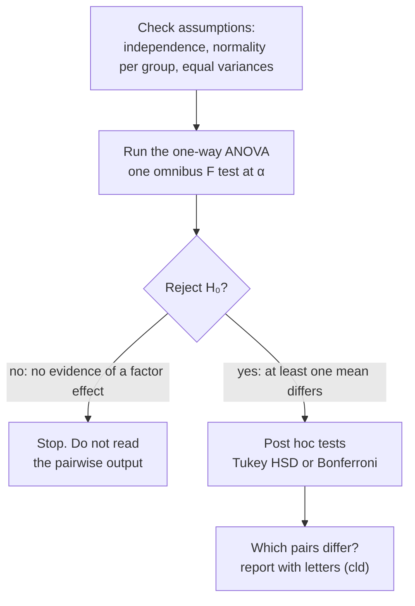

**In one line:** post hoc tests compare every pair of group means after a significant ANOVA, with p-values adjusted so the overall Type I error rate stays controlled.

> [!info] Before this, it helps to know
> [[One-Way ANOVA]] (what comes first) · [[Family-Wise Type I Error]] (why p-values are adjusted) · [[Two-Sample Independent t-Test]] (each comparison is like one)

## Start from zero
1. **A significant ANOVA says "at least one mean differs" but not which** ([[One-Way ANOVA]]).
2. **Post hocs (pairwise comparisons, "mean separation") find out.** Each one is like a two-sided two-sample test, $H_0: \mu_i = \mu_j$, run for all $k(k-1)/2$ pairs ([[Two-Sample Independent t-Test]]).
3. **Their p-values are adjusted.** *Why:* many comparisons at α each would inflate the family-wise error ([[Family-Wise Type I Error]], [[Bonferroni Correction]], [[Tukey HSD]]).
4. **When? Only after a significant omnibus ANOVA.** The ANOVA is the **gatekeeper**: [[Why we never accept the null hypothesis|fail to reject]] and the gate shuts, even if software prints Tukey results by default ([[Why post hoc tests only after a significant ANOVA]]). *Why:* the overall test protects the whole family; skipping it reopens the multiple-testing problem.
5. **Summarize the results with letters** when there are many groups ([[Compact Letter Display]]).

## See it

*What to look at:* the ANOVA is a gate. Pairwise tests only run once the gate opens, which is what keeps the overall [[Type I and Type II Errors|false-positive]] rate at α.

![[Tukey intervals.png|700]]
*What to look at:* Each row is one pair of groups with its adjusted 95% interval. Intervals that cross the dashed 0 line are not significant; red ones miss 0, so that pair differs.

## Why it exists
Adjustment is still needed *after* a significant ANOVA; you can't switch to plain t-tests just because you cleared the omnibus hurdle.

Common methods ("no wrong way"; your advisor or field may have a default):
- [[Tukey HSD]]: a common default.
- [[Bonferroni Correction]]: simplest, most [[Conservative Tests|conservative]].
- Fisher's LSD, Holm, Scheffé, Dunnett (each vs a control).
- Results summarized as SAS-style letters ([[Compact Letter Display]]).

## A tiny example
**Frustration by major** (Tukey): English − business, math − business and psychology − business all positive with all-positive CIs → business has the lowest frustration. Psychology − English positive → psychology more frustrated than English. English vs math and math vs psychology not significant.

**Costumes:** only Superman differs (higher than Hulk, Ninja Turtle, Spider-Man).

## Common confusions
- **"Read the post hocs whatever the ANOVA says."** Only after a significant ANOVA.

## Connections
- **Builds on:** [[One-Way ANOVA]], [[Family-Wise Type I Error]], [[Two-Sample Independent t-Test]]
- **Leads to:** [[Tukey HSD]], [[Bonferroni Correction]], [[Compact Letter Display]], [[TukeyHSD()]]
- **Part of:** [[MOC - ANOVA]]
- **Go deeper:** [[References|Vu and Harrington 2020, Ch. 5]] (§5.5.3)
