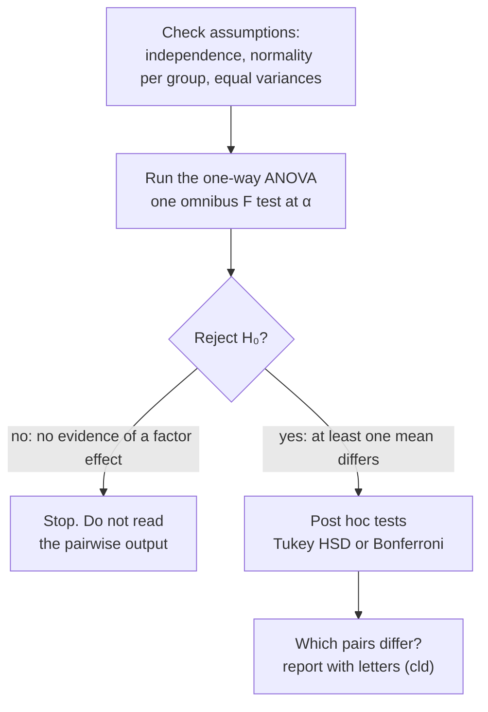

Post hoc tests compare every pair of group means after a significant ANOVA. Their p-values are adjusted so that the overall chance of a Type I error stays controlled.

A significant ANOVA says that at least one mean differs, but not which ([[One-Way ANOVA]]). Post hoc tests, also called pairwise comparisons or mean separation, find out. Each one is like a two-sided two-sample test of $H_0: \mu_i = \mu_j$, run for all $k(k-1)/2$ pairs ([[Two-Sample Independent t-Test]]).

Their p-values are adjusted, because many comparisons, each at α, would inflate the chance of a false positive across the family ([[Family-Wise Type I Error]], [[Bonferroni Correction]], [[Tukey HSD]]).

Run them only after a significant overall ANOVA. The ANOVA acts as a gatekeeper: if you [[Why we never accept the null hypothesis|fail to reject]], the gate stays shut, even if the software prints Tukey results by default ([[Why post hoc tests only after a significant ANOVA]]). The overall test protects the whole family, and skipping it reopens the multiple-testing problem. When there are many groups, summarize the results with letters ([[Compact Letter Display]]).

The ANOVA is a gate. Pairwise tests only run once the gate opens, which is what keeps the overall [[Type I and Type II Errors|false-positive]] rate at α.

![[Tukey intervals.png|700]]
Each row is one pair of groups with its adjusted 95% interval. Intervals that cross the dashed 0 line are not significant; red ones miss 0, so that pair differs.

Adjustment is still needed *after* a significant ANOVA. Clearing the overall test doesn't mean you can switch to plain t-tests.

There are several common methods, and your field or advisor may have a default:
- [[Tukey HSD|Tukey's honestly significant difference (HSD)]]: a common default.
- [[Bonferroni Correction|The Bonferroni correction]]: the simplest, and the most [[Conservative Tests|conservative]].
- Fisher's least significant difference, Holm, Scheffé, and Dunnett (each group against a control).
- Results summarized as letters, in the style of the SAS software ([[Compact Letter Display]]).

For example, in data on frustration by undergraduate major (Tukey's test), English − business, math − business and psychology − business are all positive, with confidence intervals that are entirely positive, so business students have the lowest frustration. Psychology − English is positive, so psychology students are more frustrated than English students. English against math and math against psychology are not significant.

In the Halloween costume data, only Superman differs: it is higher than Hulk, Ninja Turtle and Spider-Man.

Don't read the post hoc tests whatever the ANOVA says; read them only after a significant ANOVA.

See also: [[TukeyHSD()]].

Further reading: [[References|Vu and Harrington 2020, Ch. 5]] (§5.5.3).
