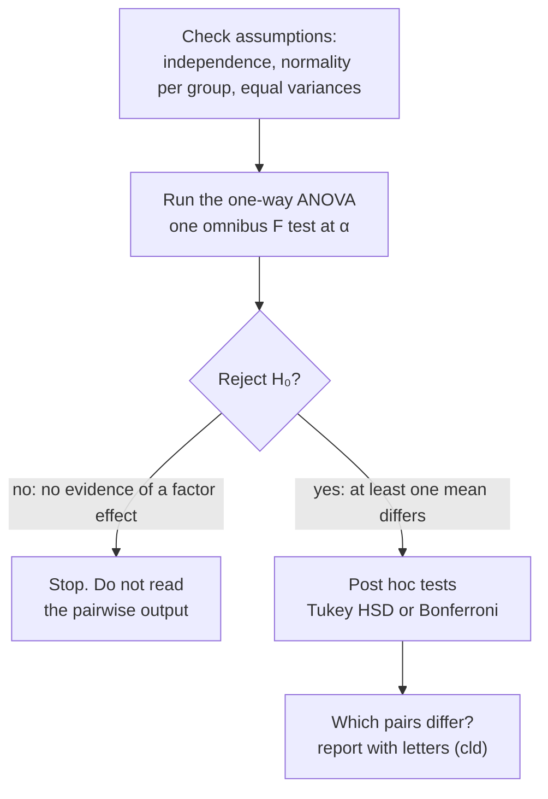

Post hoc tests compare every pair of group means after a significant ANOVA. Their p-values are adjusted so that the overall chance of a Type I error stays controlled.

Picture a smoke alarm in a big house. It goes off. Good, you know there's a fire somewhere. But which room? The alarm can't tell you. You have to walk from room to room and look.

ANOVA is the alarm. A significant ANOVA says at least one group mean differs from the others, but not which ([[One-Way ANOVA]]). Post hoc tests, also called pairwise comparisons or mean separation, are the walk through the rooms. Each one is like a two-sided two-sample test of $H_0: \mu_i = \mu_j$, and you run one for every pair, $k(k-1)/2$ of them ([[Two-Sample Independent t-Test]]).

Now there's a catch. Every room you check is another chance to "see smoke" that isn't really there. Check enough rooms at α each and you'll almost surely raise a false alarm somewhere ([[Family-Wise Type I Error]]). So post hoc tests adjust their p-values to keep the risk for the whole walk at α ([[Bonferroni Correction]], [[Tukey HSD]]).

And here's the rule that makes the whole thing honest: you only walk through the rooms if the alarm went off. If the ANOVA [[Why we never accept the null hypothesis|fails to reject]], you stop, even if the software prints Tukey results anyway ([[Why post hoc tests only after a significant ANOVA]]). The overall test is what protects the family of comparisons. Skip it and you're back to searching until something turns up.

The ANOVA is a gate. Pairwise tests only run once the gate opens, which is what keeps the overall [[Type I and Type II Errors|false-positive]] rate at α.

![[Tukey intervals.png|700]]
Each row is one pair of groups with its adjusted 95% interval. Intervals that cross the dashed 0 line are not significant; red ones miss 0, so that pair differs.

Is there a case where you don't need the walk? Yes. If the factor has only two levels, there's only one pair, so a significant F already tells you which two differ. And notice the other direction: passing the ANOVA doesn't license plain unadjusted t-tests afterwards. The adjustment is still needed.

There are several common methods, and your field or advisor may have a default:
- [[Tukey HSD|Tukey's honestly significant difference (HSD)]]: a common default.
- [[Bonferroni Correction|The Bonferroni correction]]: the simplest, and the most [[Conservative Tests|conservative]].
- Fisher's least significant difference, Holm, Scheffé, Duncan's, Student–Newman–Keuls, and Dunnett (each group against a control).
- Results summarized as letters, in the style of the SAS software ([[Compact Letter Display]]).

For example, in data on frustration by undergraduate major (Tukey's test), English − business, math − business and psychology − business are all positive, with confidence intervals that are entirely positive, so business students have the lowest frustration. Psychology − English is positive, so psychology students are more frustrated than English students. English against math and math against psychology are not significant.

In the Halloween costume data, only Superman differs: it is higher than Hulk, Ninja Turtle and Spider-Man.

Try it yourself. Your ANOVA gives p above α, but the Tukey output shows one pair with p adj below α. Do you report that pair? No. The alarm didn't go off, so you don't go looking. The order is the whole point: first ask whether there's anything to find, then ask where it is.

See also: [[TukeyHSD()]].

Further reading: [[References|Vu and Harrington 2020, Ch. 5]] (§5.5.3).
