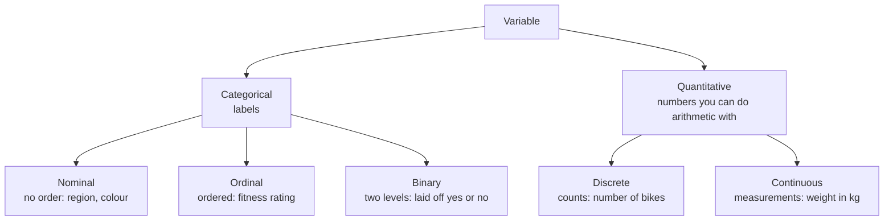

Every variable is either categorical (labels) or quantitative (numbers you can do arithmetic with), and its type decides which summaries, plots and tests make sense.

Before any summary or test, you need to know what kind of thing you're looking at. Get this wrong and every later step goes wrong with it. Every variable records something about each observation ([[Variable and Observation]]). Before summarizing it, ask one question: does arithmetic make sense on these values?

If not, the values are labels, and the variable is **categorical** (also called qualitative). You can count labels, but not average them: the mean of region codes 1, 2 and 3 is a meaningless number. Categorical variables come in three kinds:
- **Nominal:** no order, such as region, eye colour, favourite exercise or ID number.
- **Ordinal:** a natural order, such as a fitness rating from poor to excellent, or a [[Likert Scale|Likert]] agreement scale. The order is real, but the steps between levels aren't guaranteed to be equal.
- **Binary:** exactly two levels, such as yes/no or alive/dead.

If arithmetic makes sense, the variable is **quantitative** (also called numerical):
- **Discrete:** only whole units, as in "number of ...". A quick check: can 2.5 of them exist? If not, it is discrete.
- **Continuous:** any value on a scale, so fractions make sense.

```
Data
├── Categorical (qualitative): names, labels, categories
│   ├── Nominal: no order
│   ├── Ordinal: a natural order
│   └── Binary: exactly two levels
└── Quantitative (numerical)
    ├── Discrete: only whole units
    └── Continuous: an infinite scale
```


The first split, labels or numbers, decides which summaries and plots make sense; the second split refines it.

The type decides almost everything that follows, because each method only uses operations the data allow. It decides which centre to use (the [[Mode|mode]], the [[Median|median]] or the [[Mean|mean]]: [[Why the median beats the mean for skewed data]]), which plot ([[Plots for Categorical Data]], [[Histogram]]) and which test ([[Test Choice Guide]]). Unordered categories have no shape, because their bars can be put in any order ([[Shape of a Distribution]]). Counts often aren't normal, which most classical tests assume ([[Normality Checks]]). In t-tests and ANOVA, the [[Independent and Dependent Variables|explanatory variable]] is categorical (a factor) and the response is quantitative ([[Factors and Levels]]).

For example, the variables in a survey:

| Variable | Type | Why |
|---|---|---|
| ID | categorical nominal | 1 + 2 doesn't have to equal 3 |
| Age | quantitative continuous (in theory) | a child can be 2½ |
| Weight (kg) | quantitative continuous | half a kg makes sense |
| Fitness rating | categorical ordinal | poor < fair < good |
| Favourite exercise | categorical nominal | no order |
| Number of bikes owned | quantitative discrete | "number of" |

The question is never "is it a number?" but "does arithmetic on it mean anything?" Being a number doesn't make a variable quantitative: ID numbers and treatment codes are labels. And discrete doesn't mean categorical: discrete data are quantitative counts.

See also: [[Random Variable]].

Further reading: [[References|Vu and Harrington 2020, Ch. 1]] (§1.2, p. 15).
