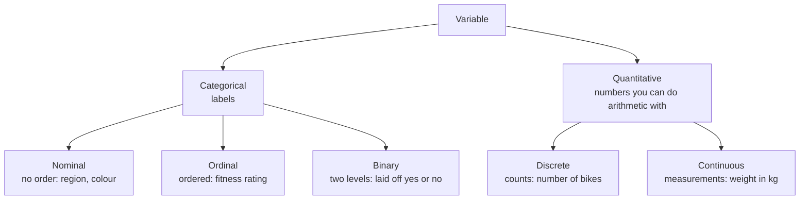

**In one line:** a variable is either categorical (labels: nominal, ordinal or binary) or quantitative (numbers you can do arithmetic with: discrete or continuous), and that type decides which summaries and tests make sense.

> [!info] Before this, it helps to know
> [[Variable and Observation]] (what is being classified)

## Start from zero
1. **Every variable records something about each observation** ([[Variable and Observation]]). Before summarizing it, ask one question: **does arithmetic make sense on these values?**
2. **If not, the values are labels: categorical (qualitative).** You can count them, but not average them. *Why it matters:* the mean of "region" codes 1, 2, 3 is a meaningless number.
   - **Nominal:** no order (region, eye colour, favourite exercise, subject ID).
   - **Ordinal:** a natural order (fitness rating poor → excellent, [[Likert Scale|Likert]] agree scales). Order exists, but the steps between levels aren't guaranteed equal.
   - **Binary:** exactly two levels (yes/no, laid off, alive/dead).
3. **If arithmetic makes sense, the values are quantitative (numerical).**
   - **Discrete:** only whole units ("number of ..."). The half-unit check: can 2.5 of them exist? If not, discrete.
   - **Continuous:** an infinite scale; fractions make sense.

```
Data
├── Categorical (qualitative): names, labels, categories
│   ├── Nominal: no order
│   ├── Ordinal: a natural order
│   └── Binary: exactly two levels
└── Quantitative (numerical)
    ├── Discrete: only whole units
    └── Continuous: an infinite scale
```

4. **The type decides everything downstream:** which centre (mode, [[Median|median]] or mean: [[Why the median beats the mean for skewed data]]), which plot ([[Plots for Categorical Data]], [[Histogram]]) and which test ([[Test Choice Guide]]). *Why:* each method uses only the operations the data type allows.

## See it


*What to look at:* the first split (labels vs numbers) decides which summaries and plots make sense; the second split refines it.

## Why it exists
Choosing the right analysis starts here; the test-choice flow chart begins with the data type ([[Test Choice Guide]]).
- Only the **mode** is a meaningful center for unordered categories ([[Mode]]).
- Categorical unordered variables have **no shape**; the bars can be rearranged ([[Shape of a Distribution]]).
- Discrete counts often violate normality, which most classical tests assume ([[Normality Checks]]).
- In t-tests and ANOVA the [[Independent and Dependent Variables|explanatory variable]] is categorical (a factor) and the response is quantitative ([[Factors and Levels]]).

## A tiny example
A survey:

| Variable | Type | Why |
|---|---|---|
| ID | categorical nominal | 1 + 2 doesn't have to equal 3 |
| Age | quantitative continuous (in theory) | a child can be 2½ |
| Weight (kg) | quantitative continuous | half a kg makes sense |
| Fitness rating | categorical ordinal | poor < fair < good |
| Favourite exercise | categorical nominal | no order |
| Number of bikes owned | quantitative discrete | "number of" |

## Common confusions
- **"If it's a number, it's quantitative."** ID numbers and treatment codes are labels.
- **"Discrete means categorical."** Discrete is a kind of *quantitative* data (counts).

## Connections
- **Builds on:** [[Variable and Observation]]
- **Leads to:** [[Mean]], [[Mode]], [[Factors and Levels]], [[Test Choice Guide]], [[Random Variable]]
- **Part of:** [[MOC - Describing Data]]
- **Go deeper:** [[References|Vu and Harrington 2020, Ch. 1]] (§1.2, p. 15)
