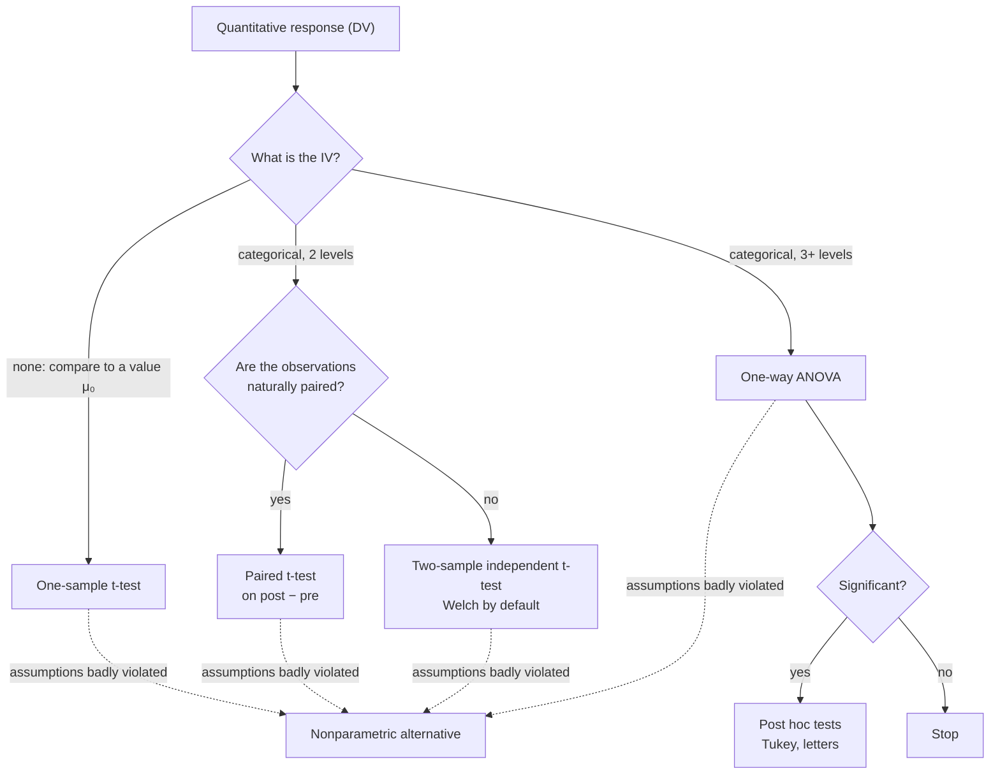

This guide picks the right test from two questions about your data. Choosing a test isn't a lookup exercise. Each test is built for one kind of question and one kind of data, and if you understand what your data are, the choice makes itself. What type is your outcome, the [[Independent and Dependent Variables|dependent variable]] (DV)? And what type is the thing you compare by, the independent variable (IV)? This table covers the tests in this wiki.

| Outcome (dependent variable) | Explanatory (independent variable) | Design | Test |
|---|---|---|---|
| A measured amount | none, compared with a fixed value μ₀ | one sample | [[One-Sample t-Test]] |
| A measured amount | groups, 2 of them | paired: the same unit measured twice, or matched units | [[Paired t-Test]] |
| A measured amount | groups, 2 of them | independent groups | [[Two-Sample Independent t-Test]] |
| A measured amount | groups, 3 or more, from one factor | independent groups | [[One-Way ANOVA]], then [[Post Hoc Tests]] if it is significant |
| A measured amount, with the assumptions badly broken | any of the above | | [[Nonparametric Alternatives]] |

## See it as a flowchart

Two questions pick the test: what type the independent variable is, and, for two groups, whether the data are paired.

## The workflow around any test
1. **Plot and describe the data first.** A plot shows the size and direction of the effect, [[Outliers|outliers]] and unequal spreads before a p-value can hide them ([[Why visualize data before testing]]).
2. **Check the assumptions.** The p-value comes from a null distribution that is only correct when the assumptions hold ([[Why check assumptions before trusting a test]], [[Null Distribution]]).
3. **Run the test and check the degrees of freedom.** They show how many observations R actually used, which catches dropped missing values and data in the wrong format ([[Why use degrees of freedom as a sanity check]]).
4. **Report the test statistic, the degrees of freedom, the p-value, a [[Confidence Interval|confidence interval]] and an effect size.** The p-value says whether there is evidence of an effect. The confidence interval and the effect size say how big it is ([[Why report an effect size with the p-value]]).
5. **Write the conclusion in context.** The reader cares about the sheep or the swimmers, not about $H_0$ ([[Writing a Conclusion]]).

## How to run each one

![[Running a test - six steps.png|700]]
Every test follows the same six steps. Only the formula in step 4 changes.

The table shows why each step is there, and why it comes in this order.

| Step | Why it is done | Why it comes here |
|---|---|---|
| 1. Pick the test | The test must match the data types and the design. Otherwise its null distribution describes a different situation ([[Types of Data]], [[Independent vs Paired Samples]]). | Everything after it depends on which test it is. |
| 2. Hypotheses and α | They turn the question into a claim about a [[Parameter vs Statistic\|parameter]], and they fix what counts as "rare" ([[Null and Alternative Hypotheses]], [[Significance Level]]). | They are set before seeing the data, so the results can't steer them ([[Why choose alpha and tails before seeing the data]]). |
| 3. Check the [[Test Assumptions\|requirements]] | The p-value is only right if independence, [[Normality Checks\|normality]] and, for the pooled test, [[Homogeneity of Variance\|equal variances]] hold ([[Robustness]]). | Before trusting any statistic, because a failed check changes the test. |
| 4. Calculate by hand | It shows what the statistic really is: signal divided by noise ([[Signal and Noise]], [[Test Statistic]]). | The formula is the only step that changes between tests. |
| 5. Run it in R | R gives exact p-values and confidence intervals with no tables to look up, and the degrees of freedom confirm that R used the right data. | After the hand calculation, so you can check R's numbers against it. |
| 6. Decide and report | Compare p with α, then give the size of the effect with a confidence interval and an effect size ([[Writing a Conclusion]], [[Effect Size]]). | Last, because it uses every number above. |

Each of these notes has a worked example that goes through all six steps on real data from the book, with the calculation by hand, the R code and its output, and a sentence for the report:

| Test | Worked example |
|---|---|
| [[One-Sample t-Test]] | mercury in white croaker fish, compared with the action level of 0.50 parts per million (from summary statistics only) |
| [[Paired t-Test]] | 12 swimmers, each in a wetsuit and in a swimsuit |
| [[Two-Sample Independent t-Test]] | stem cell treatment versus control in 18 sheep |
| [[One-Way ANOVA]] | arm strength across 3 ACTN3 genotypes, followed by [[Tukey HSD\|Tukey's test]] |
| [[Nonparametric Alternatives]] | the same data, using ranks |

The raw data are in the `Data` folder as comma-separated (CSV) files, ready for `read.csv(file.choose())`.

Try it yourself. Pick the test for each. (a) Blood pressure of the same 8 patients before and after a drug. (b) Yield under 4 different fertilizers, different plots for each. (c) Body temperature of a sample of people, compared with a textbook value. Answers: (a) paired t-test, since each patient is measured twice; (b) one-way ANOVA, one factor with 4 levels, then post hoc tests if it's significant; (c) one-sample t-test against the fixed value.

See also: [[MOC - t-Tests]], [[MOC - ANOVA]], [[Independent vs Paired Samples]], [[Factors and Levels]], [[Formula Sheet]].
