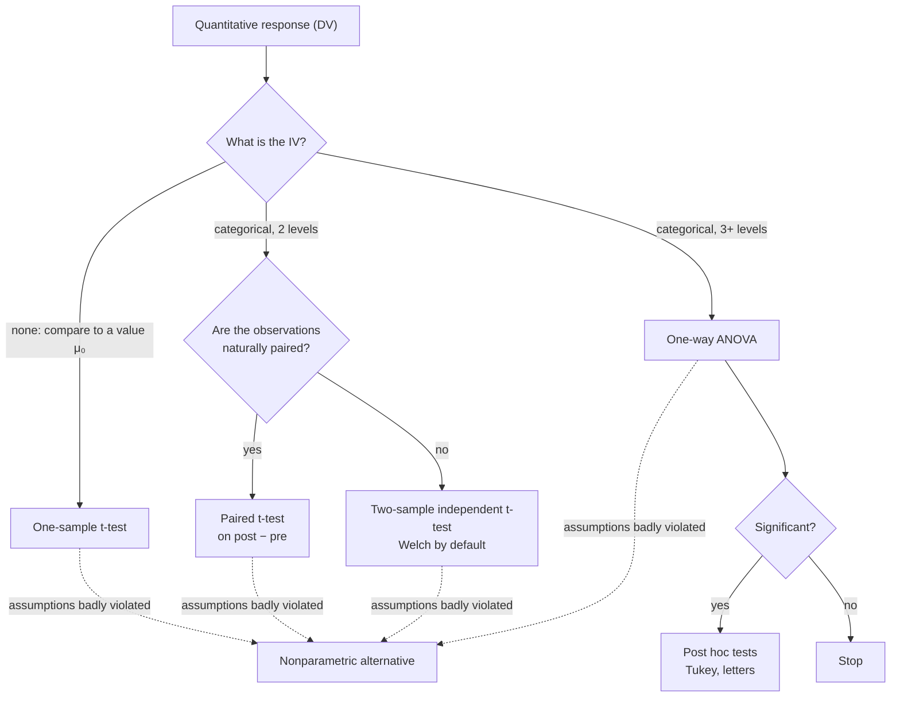

Frame every test choice as "what type is my [[Independent and Dependent Variables|IV]], and what type is my DV?". This table covers the tests in this wiki so far.

| Response (DV) | Explanatory (IV) | Design | Test |
|---|---|---|---|
| Quantitative | none, compare to a value μ₀ | one sample | [[One-Sample t-Test]] |
| Quantitative | categorical, 2 levels | paired (same unit twice, matched) | [[Paired t-Test]] |
| Quantitative | categorical, 2 levels | independent groups | [[Two-Sample Independent t-Test]] |
| Quantitative | categorical, 3+ levels, one factor | independent groups | [[One-Way ANOVA]], then [[Post Hoc Tests]] if significant |
| Quantitative, assumptions badly violated | any of the above | | [[Nonparametric Alternatives]] |

Going further: [[Two-Way ANOVA and Interaction|two-way ANOVA]] (two factors), [[Regression|regression]] (quantitative IV), [[Chi-Square Test|chi-square]] (categorical DV and IV) and logistic regression (binary DV).

## See it as a flowchart

*What to look at:* two questions pick the test: what type the IV is, and (for two groups) whether the data are paired.

## The workflow around any test
1. **Plot and describe first.** *Why:* a plot shows the size and direction of the effect, [[Outliers|outliers]] and unequal spreads before any p-value can hide them ([[Why visualize data before testing]]).
2. **Check assumptions.** *Why:* the p-value comes from a null distribution that is only correct when the assumptions hold ([[Why check assumptions before trusting a test]], [[Null Distribution]]).
3. **Run the test and sanity-check df.** *Why:* the df show how many observations R actually used, which catches dropped NAs and wrong formats ([[Why use degrees of freedom as a sanity check]]).
4. **Report the statistic, df, p, [[Confidence Interval|CI]] and an effect size.** *Why:* p says whether there is evidence of an effect; the CI and effect size say how big it is ([[Why report an effect size with the p-value]]).
5. **Write the conclusion in context.** *Why:* the reader cares about the sheep or the swimmers, not about $H_0$ ([[Writing a Conclusion]]).

## How to run each one

![[Running a test - six steps.png|700]]
*What to look at:* every test follows the same six steps; only the formula in step 4 changes.

**Why each of the six steps is there, and why in this order:**

| Step | Why it is done | Why it comes here |
|---|---|---|
| 1. Pick the test | the test must match the data types and the design, or its null distribution describes a different situation ([[Types of Data]], [[Independent vs Paired Samples]]) | everything after depends on which test it is |
| 2. Hypotheses and α | they turn the question into a claim about a [[Parameter vs Statistic\|parameter]] and fix what counts as "rare" ([[Null and Alternative Hypotheses]], [[Significance Level]]) | before the data, so the results can't steer them ([[Why choose alpha and tails before seeing the data]]) |
| 3. Check the [[Test Assumptions\|requirements]] | the p-value is only right if independence, [[Normality Checks\|normality]] and (for pooling) [[Homogeneity of Variance\|equal variances]] hold ([[Robustness]]) | before trusting any statistic; a failed check changes the test |
| 4. Calculate by hand | shows what the statistic is: signal ÷ noise ([[Signal and Noise]], [[Test Statistic]]) | the formula is the only step that changes between tests |
| 5. Run it in R | exact p-values and CIs without table lookups; the df confirm R used the right data | after the hand calculation, so you can check R's numbers against it |
| 6. Decide and report | compare p with α, then give the size of the effect with a CI and an effect size ([[Writing a Conclusion]], [[Effect Size]]) | last, because it uses every number above |

Each test note has a **How to run it** section that walks through all six steps on real book data, with the calculation by hand, the R code and its output, and a reporting sentence:

| Test | Worked example |
|---|---|
| [[One-Sample t-Test#How to run it]] | mercury in white croaker vs the 0.50 ppm action level (summary statistics only) |
| [[Paired t-Test#How to run it]] | 12 swimmers in a wetsuit and a swimsuit |
| [[Two-Sample Independent t-Test#How to run it]] | stem cells vs control in 18 sheep |
| [[One-Way ANOVA#How to run it]] | arm strength across 3 ACTN3 genotypes, then [[Tukey HSD\|Tukey]] |
| [[Nonparametric Alternatives#How to run it]] | the same data, ranked |

The raw data are in the vault's `Data` folder as CSV files, ready for `read.csv(file.choose())`.

## Connections
- **Part of:** [[MOC - t-Tests]], [[MOC - ANOVA]]
- **Related:** [[Independent vs Paired Samples]], [[Factors and Levels]], [[Formula Sheet]]
