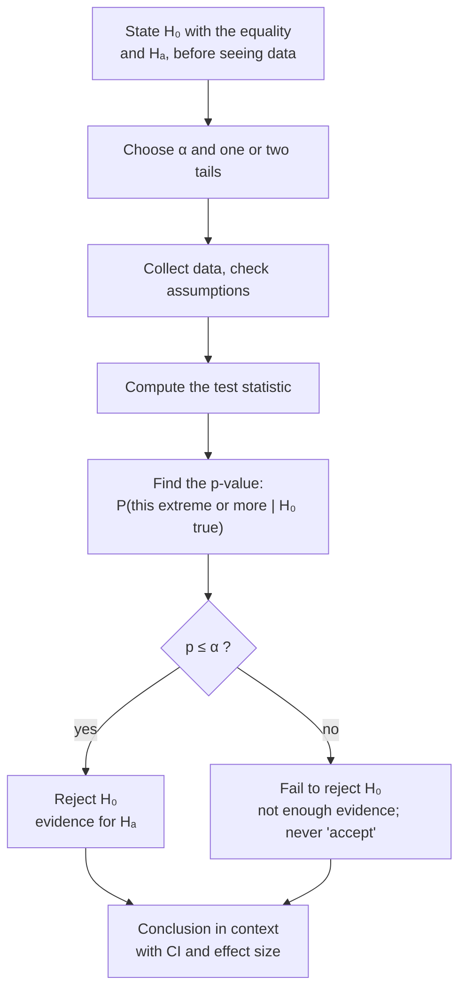

A hypothesis test assumes the null hypothesis is true and asks how surprising the data would be under that [[Test Assumptions|assumption]]. If the data would be very surprising, the test rejects the null.

The logic is the rare event rule: assume a claim, and if what you observe would be very rare under it, doubt the claim ([[Rare Event Rule]]). Every test turns that into the same procedure, and each step has a reason:
1. **State the hypotheses and set α.** $H_0$ and $H_A$ are claims about a [[Parameter vs Statistic|population parameter]], and α is usually 0.05 ([[Null and Alternative Hypotheses]], [[Significance Level]]). These come first so the data can't influence them ([[Why choose alpha and tails before seeing the data]]).
2. **Check the conditions:** a random sample, independence, and [[Normality Checks|normality]] or a large $n$. The null distribution in step 4 is only correct if these hold ([[Why check assumptions before trusting a test]]).
3. **Turn the sample statistic into a test statistic** ([[Test Statistic]]). Putting the result on a standard scale, as standard errors away from the null value, lets one known distribution serve every study.
4. **Find the p-value:** the probability of a result as extreme or more, **assuming $H_0$ is true** ([[P-Value]], [[Null Distribution]]). Which [[Tails of a Distribution|tail]] to use depends on $H_A$ ([[One-Tailed vs Two-Tailed Tests]]).
5. **Decide.** If p ≤ α, reject $H_0$. If p > α, fail to reject it. Never say you "accept" it: a result that isn't rare is consistent with $H_0$ but doesn't prove it ([[Why we never accept the null hypothesis]]).
6. **Write the conclusion in context** ([[Writing a Conclusion]]). The reader cares about the plants or the patients, not about $H_0$.

The book's five steps are the same idea: hypotheses, conditions, [[Point Estimate|point estimate]], test statistic and p-value, and a conclusion in context ([[References|Vu and Harrington 2020, Ch. 4]], §4.3). Afterwards, report how big the effect is, because p only says whether there is evidence of one ([[Why report an effect size with the p-value]]).

Every test follows this same path; only the test statistic in the middle changes.

A test gives a disciplined way, fixed in advance, to decide whether an observed difference is bigger than chance alone would produce, while [[Experiment|controlling]] the false-alarm rate α.

For example, think of a courtroom. $H_0$ is the presumption of innocence. Either there is enough evidence to reject it ("guilty") or there isn't ("not guilty"). "Not guilty" isn't the same as "innocent", which is why we never "accept" $H_0$.

A test doesn't tell you the probability that $H_0$ is true. It tells you how unusual the data would be if $H_0$ were true. And failing to reject doesn't prove there is no effect; it means there isn't enough evidence.

See also: [[Sampling Distribution]], [[Type I and Type II Errors]].

Further reading: [[References|Vu and Harrington 2020, Ch. 4]] (§4.3, p. 212).
