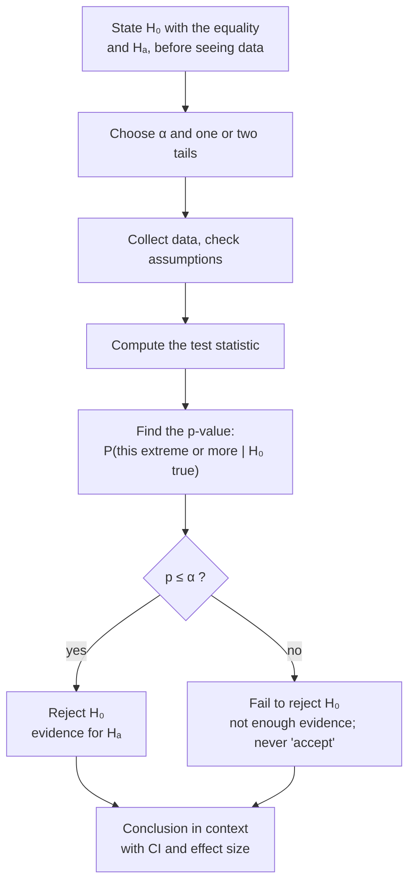

A hypothesis test is a careful way of asking "could this just be chance?" You pretend nothing is going on, work out what the data would then look like, and if your real data look very different, you stop pretending.

Imagine a detective. A suspect says, "I was home all night." The detective doesn't argue. She says, "Fine, suppose that's true. Then your car shouldn't have mud on it, and nobody should have seen you at the docks." Then she checks. If the facts are badly at odds with the story, the story goes.

That's all a hypothesis test is. Assume the boring story, see what it predicts, check the facts ([[Rare Event Rule]]). The rest is just doing it carefully, with numbers, so you can't fool yourself. Here are the steps, and why each one is there:
1. **Write down the boring story and the interesting one, and decide how surprised you'd need to be.** The boring story is $H_0$, the interesting one $H_A$, and the "how surprised" cutoff is α, usually 0.05 ([[Null and Alternative Hypotheses]], [[Significance Level]]). You do this first, before peeking, so the data can't tempt you into moving the goalposts ([[Why choose alpha and tails before seeing the data]]).
2. **Check that the method fits.** Is it a random sample? Are the values independent? Roughly normal, or a big enough $n$? The math in step 4 only works if these hold ([[Normality Checks]], [[Why check assumptions before trusting a test]]).
3. **Measure the surprise.** Take the gap between what you saw and what the boring story predicts, and divide by how much that gap would wobble by chance. That gives the [[Test Statistic|test statistic]].
4. **Ask how often chance alone would give a surprise this big.** That's the [[P-Value|p-value]], worked out assuming $H_0$ is true ([[Null Distribution]]). Which side counts as surprising depends on $H_A$ ([[Tails of a Distribution|tails]], [[One-Tailed vs Two-Tailed Tests]]).
5. **Decide.** If p ≤ α, reject $H_0$. If not, fail to reject it. Never say "accept": the facts not contradicting the alibi doesn't prove the alibi ([[Why we never accept the null hypothesis]]).
6. **Say what it means for the real thing.** Nobody cares about $H_0$. They care about the plants, the patients, the ice cream ([[Writing a Conclusion]]).

The book lists five steps, but it's the same recipe: hypotheses, conditions, a [[Point Estimate|point estimate]], the test statistic and p-value, and a conclusion in context ([[References|Vu and Harrington 2020, Ch. 4]], §4.3). Afterwards, say how big the effect is, because the p-value only tells you whether there's evidence of *something* ([[Why report an effect size with the p-value]]).

Every test follows this same path; only the test statistic in the middle changes.

Why bother with all this ceremony? Because people are very good at seeing patterns, including ones that aren't there. Give anyone two groups of numbers and they'll find a difference. The test is a rule, fixed in advance, for deciding whether a difference is bigger than chance would usually make, while keeping the rate of false alarms at α ([[Experiment]]).

A courtroom works the same way. $H_0$ is "innocent until proven guilty". Either the evidence is strong enough to reject it ("guilty"), or it isn't ("not guilty"). And "not guilty" doesn't mean "innocent". It means the case wasn't proven.

Try it yourself. A test gives a p-value of about one in three. Does that tell you the chance $H_0$ is true? No. It tells you that *if* $H_0$ were true, data like yours would turn up about one time in three, which is not surprising at all. So you fail to reject. And notice what you haven't learned: whether there's no effect, or a small one your study couldn't see. A test is a filter against fooling yourself, not a machine that tells you the truth.

See also: [[Sampling Distribution]], [[Type I and Type II Errors]], [[Parameter vs Statistic|population parameter]].

Further reading: [[References|Vu and Harrington 2020, Ch. 4]] (§4.3, p. 212).
