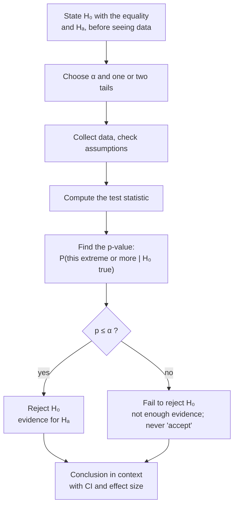

**In one line:** a hypothesis test assumes the null hypothesis is true, asks how surprising the data would be under that [[Test Assumptions|assumption]], and rejects the null if the data would be very surprising.

> [!info] Before this, it helps to know
> [[Rare Event Rule]] (the logic) · [[Null and Alternative Hypotheses]] (step 1) · [[Null Distribution]] (what the test compares against) · [[Sampling Distribution]] (why a null distribution exists)

## Start from zero
1. **The logic is the rare event rule:** assume a claim, and if what you observe would be very rare under it, doubt the claim ([[Rare Event Rule]]).
2. **Turn that into a procedure, used for every test.** Each step has a reason:
   1. **State $H_0$ and $H_A$ about a [[Parameter vs Statistic|population parameter]]; set α** (usually 0.05) ([[Null and Alternative Hypotheses]], [[Significance Level]]). *Why first:* the hypotheses and cutoff must be fixed before the data can influence them ([[Why choose alpha and tails before seeing the data]]).
   2. **Check conditions:** random sample, independence, [[Normality Checks|normality]] or large $n$. *Why:* the null distribution in step 4 is only correct if these hold ([[Why check assumptions before trusting a test]]).
   3. **Turn the sample statistic into a test statistic** ([[Test Statistic]]). *Why:* putting the result on a standard scale (SEs from the null value) lets one known distribution serve every study.
   4. **Find the p-value:** the probability of a result as or more extreme, **assuming $H_0$ is true** ([[P-Value]], [[Null Distribution]]). Which [[Tails of a Distribution|tail]] depends on $H_A$ ([[One-Tailed vs Two-Tailed Tests]]).
   5. **Decide: p ≤ α → reject $H_0$** ("P-value low, reject the H-O respectfully"); **p > α → fail to reject**. *Why never "accept":* a non-rare result is consistent with $H_0$ but doesn't prove it ([[Why we never accept the null hypothesis]]).
   6. **Write the conclusion in context** ([[Writing a Conclusion]]). *Why:* the reader cares about the plants or patients, not about $H_0$.
3. **The book's five steps are the same idea:** hypotheses → conditions → [[Point Estimate|point estimate]] → test statistic and p-value → conclusion in context ([[References|Vu and Harrington 2020, Ch. 4]], §4.3).
4. **Then report how big the effect is,** because p only says whether there is evidence of one ([[Why report an effect size with the p-value]]).

## See it

*What to look at:* every test follows this same path; only the test statistic in the middle changes.

## Why it exists
It gives a disciplined, pre-specified way to decide whether an observed difference is bigger than chance alone would produce, while [[Experiment|controlling]] the false-alarm rate α.

## A tiny example
**The courtroom analogy.** $H_0$ is the presumption of innocence. Either there is enough evidence to reject it ("guilty") or there isn't ("not guilty"). **"Not guilty" ≠ "innocent"**, so we never "accept" $H_0$ ([[Why we never accept the null hypothesis]]).

## Common confusions
- **"The test tells me the probability $H_0$ is true."** It tells me how unusual the data are if $H_0$ were true.
- **"Failing to reject proves no effect."** It means not enough evidence.

## Connections
- **Builds on:** [[Rare Event Rule]], [[Null and Alternative Hypotheses]], [[Sampling Distribution]], [[Null Distribution]]
- **Leads to:** [[Test Statistic]], [[P-Value]], [[Type I and Type II Errors]], [[Writing a Conclusion]]
- **Part of:** [[MOC - Inference Foundations]]
- **Go deeper:** [[References|Vu and Harrington 2020, Ch. 4]] (§4.3, p. 212)
