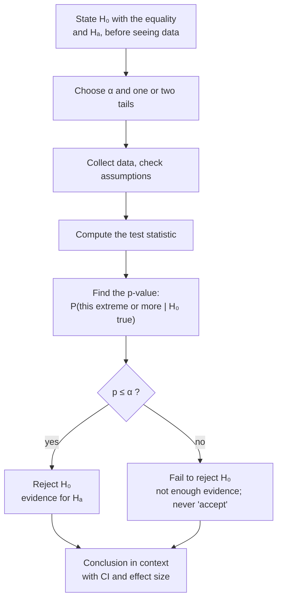

The null hypothesis ($H_0$) is the boring story: no effect, no difference, nothing has changed. The alternative hypothesis ($H_A$) is the interesting story you're hoping the data will support.

Suppose a farmer says a new feed makes chickens heavier. How would you check? You can't just weigh some chickens on the new feed and say "see, heavy!" Heavy compared to what? You need something definite to compare against.

So here's the trick. You take the boring story, "the feed does nothing, the average weight is the same as always", and you pin it down to an exact number. Why exact? Because only an exact claim lets you work out what the data *should* look like. "The feed does something" doesn't tell you what to expect; it could do a little or a lot. "The feed does nothing, the mean is still $\mu_0$" tells you exactly where the results should land, give or take chance ([[Null Distribution]], [[Sampling Distribution]]). That exact boring claim, with its equals sign, is the null hypothesis, $H_0$.

The interesting story becomes the alternative, $H_A$. It's about the same number, but with "less than", "greater than" or "not equal to" instead of "equals" ([[Inequality Signs]]). Its direction decides where you look for surprises, in one [[Tails of a Distribution|tail]] or both ([[One-Tailed vs Two-Tailed Tests]]).

Notice what both stories are about. Not the chickens you weighed. You already know their average exactly; there's nothing to test. They're about *all* the chickens that could get this feed, which you can't see. So hypotheses are always about population values like $\mu$ or $p$, never about sample values like $\bar{x}$ ([[Parameter vs Statistic]], [[PICO Question]]).

Every test follows this same path; only the [[Test Statistic|test statistic]] in the middle changes.

Here's the funny part. The whole game is lopsided. Data can knock the boring story down, but data can never prove it. If the chickens come out about the same, maybe the feed does nothing, or maybe it does a little and your study was too small to notice. So you never "accept" $H_0$; you only fail to reject it ([[Why we never accept the null hypothesis]]). The null isn't what you believe. It's a position you take for the sake of argument, to see if the data can push it over.

And you write both stories down *before* you look at the data. Otherwise it's too easy to pick, after the fact, whichever story the data happen to fit.

For example:

| Situation | $H_0$ | $H_A$ |
|---|---|---|
| Vegetarian diet lowers cholesterol | $\mu = 190$ | $\mu < 190$ |
| Salmonella above the safe level | $\mu = 0.3$ | $\mu > 0.3$ |
| Body temperature isn't 98.6 °F | $\mu = 98.6$ | $\mu \ne 98.6$ |
| Two diets differ | $\mu_1 - \mu_2 = 0$ | $\mu_1 - \mu_2 \ne 0$ |
| One-way ANOVA | $\mu_1 = \cdots = \mu_k$ | at least one mean differs |

Try it yourself. What's wrong with writing $H_0: \bar{x} = 5$? The sample mean $\bar{x}$ is something you already calculated; it either is 5 or it isn't, and there's no question to test. Write it about $\mu$. And for ANOVA, why not $H_A: \mu_1 \ne \mu_2 \ne \mu_3$? Because the boring story breaks if even one mean is different, so the honest alternative is simply "at least one mean differs".

See also: [[Hypothesis Testing]], [[Writing a Conclusion]].

Further reading: [[References|Vu and Harrington 2020, Ch. 4]] (§4.3).
