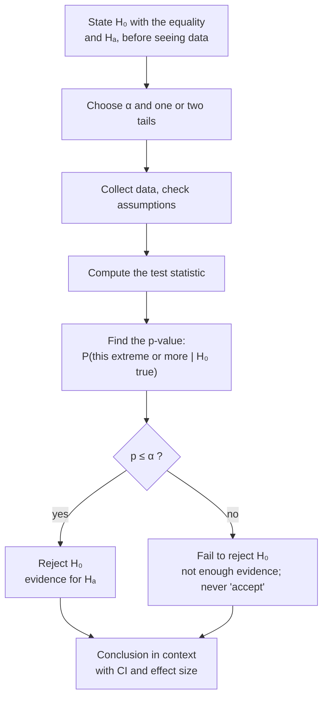

The null hypothesis ($H_0$) is the claim of no effect, or that nothing has changed, and it contains an equals sign. The alternative hypothesis ($H_A$) is a strict [[Inequality Signs|inequality]] about the same parameter, usually what the researcher hopes to show.

A test needs something to push against. So before any data, you turn your question into two competing claims, and you make one of them precise enough to calculate from. A [[PICO Question|research question]] becomes a claim about a population parameter ($\mu$, $p$, $\mu_1 - \mu_2$), never about a sample statistic. You already know the sample statistic exactly, so there is nothing to test about it; the uncertainty is about the population ([[Parameter vs Statistic]]).

The boring claim becomes the null, $H_0$. It's the world where nothing interesting is happening: "no effect", "no difference", or "the old value still holds". $H_0$ contains an equality ($=$; some texts write $\le$ or $\ge$). It needs one because, to calculate anything, we need the [[Sampling Distribution|sampling distribution]] under $H_0$, and that distribution must be **centred at one specific value $\mu_0$** ([[Null Distribution]]).

The claim you hope to support becomes the alternative, $H_A$. It is a strict inequality ($<$, $>$ or $\ne$) about the **same parameter and the same value**. Its direction decides which [[Tails of a Distribution|tails]] the test uses ([[One-Tailed vs Two-Tailed Tests]]).

Notice the asymmetry. Evidence can only push against $H_0$. The test asks whether the data would be rare if $H_0$ were true; it never proves $H_0$ ([[Why we never accept the null hypothesis]]).

Every test follows this same path; only the [[Test Statistic|test statistic]] in the middle changes.

Writing the hypotheses before seeing the data fixes what counts as evidence and which tail to use.

For example:

| Situation | $H_0$ | $H_A$ |
|---|---|---|
| Vegetarian diet lowers cholesterol | $\mu = 190$ | $\mu < 190$ |
| Salmonella above the safe level | $\mu = 0.3$ | $\mu > 0.3$ |
| Body temperature isn't 98.6 °F | $\mu = 98.6$ | $\mu \ne 98.6$ |
| Two diets differ | $\mu_1 - \mu_2 = 0$ | $\mu_1 - \mu_2 \ne 0$ |
| One-way ANOVA | $\mu_1 = \cdots = \mu_k$ | at least one mean differs |

So the null isn't what you believe. It's the position you take for the sake of argument, to see whether the data can knock it down. Never put sample statistics in hypotheses: $H_0: \bar{x} = 5$ is wrong. And for ANOVA, don't write $H_A: \mu_1 \ne \mu_2 \ne \mu_3$; write "at least one mean differs".

See also: [[Hypothesis Testing]], [[Writing a Conclusion]].

Further reading: [[References|Vu and Harrington 2020, Ch. 4]] (§4.3).
