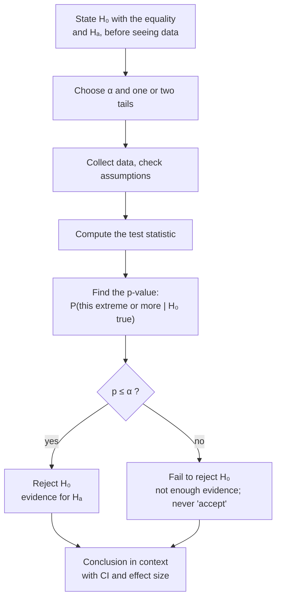

The null hypothesis ($H_0$) is the "no effect / status quo" claim containing an equality; the alternative ($H_A$) is a strict [[Inequality Signs|inequality]] about the same parameter, usually what the researcher hopes to show.

1. **A [[PICO Question|research question]] becomes a claim about a population parameter** ($\mu$, $p$, $\mu_1 - \mu_2$), never about a statistic. "You don't test your own height; you measure it." *Why:* you already know the sample statistic exactly; the uncertainty is about the population ([[Parameter vs Statistic]]).
2. **Write the boring claim as the null, $H_0$:** "no effect", "no difference", "the old value still holds".
3. **$H_0$ contains equality** ($=$; some texts write $\le$ or $\ge$). Mnemonic: **"equality for H-O's."** *Why the equality is needed:* to compute anything we need the [[Sampling Distribution|sampling distribution]] under $H_0$, and that distribution must be **centred at one specific value $\mu_0$** ([[Null Distribution]]).
4. **Write the claim you hope to support as the alternative, $H_A$:** a strict inequality ($<$, $>$, $\ne$) about the **same parameter and the same value**. Its direction decides the [[Tails of a Distribution|tails]] of the test ([[One-Tailed vs Two-Tailed Tests]]).
5. **Evidence can only push against $H_0$.** The test asks whether the data would be rare if $H_0$ were true; it never proves $H_0$ ([[Why we never accept the null hypothesis]]).

Every test follows this same path; only the [[Test Statistic|test statistic]] in the middle changes.

Writing hypotheses before seeing the data fixes what counts as evidence and which tail to use. The direction of $H_A$ decides the test type ([[One-Tailed vs Two-Tailed Tests]]).

For example:

| Situation | $H_0$ | $H_A$ |
|---|---|---|
| Vegetarian diet lowers cholesterol | $\mu = 190$ | $\mu < 190$ |
| Salmonella above the safe level | $\mu = 0.3$ | $\mu > 0.3$ |
| Body temperature isn't 98.6 °F | $\mu = 98.6$ | $\mu \ne 98.6$ |
| Two diets differ | $\mu_1 - \mu_2 = 0$ | $\mu_1 - \mu_2 \ne 0$ |
| One-way ANOVA | $\mu_1 = \cdots = \mu_k$ | at least one mean differs |

Common mistakes:

- **"$H_0: \bar{x} = 5$."** Never use sample statistics in hypotheses.
- **"$H_A: \mu_1 \ne \mu_2 \ne \mu_3$."** For ANOVA, write "at least one mean differs".

See also: [[Hypothesis Testing]], [[Writing a Conclusion]].

Further reading: [[References|Vu and Harrington 2020, Ch. 4]] (§4.3).
