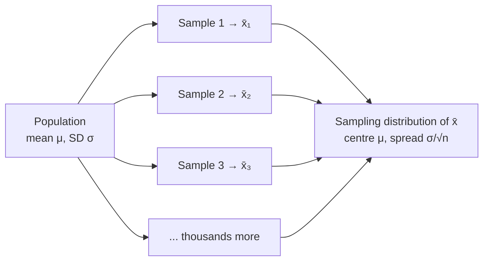

**In one line:** a sampling distribution is the distribution of a statistic (like $\bar{x}$) over all possible samples of the same size from the same population.

> [!info] Before this, it helps to know
> [[Population and Sample]] (where samples come from) · [[Parameter vs Statistic]] (the thing that varies is a statistic) · [[Random Variable]] (a statistic is one) · [[Probability Distribution]] (what a distribution is)

## Start from zero
1. **A statistic depends on which sample you happened to get.** Measure 30 different plants and $\bar{x}$ comes out a bit different ([[Parameter vs Statistic]]).
2. **So before you sample, $\bar{x}$ is a random variable:** its value is a number decided by chance ([[Random Variable]]).
3. **Every random variable has a distribution:** the list of values it can take and how likely each is ([[Probability Distribution]]).
4. **The sampling distribution is that distribution for a statistic:** the values of $\bar{x}$ from *all possible* samples of size $n$, and how often each would occur. *Why we need it:* it tells us how far a sample statistic typically lands from the parameter, which is what every interval and test uses ([[Why the sampling distribution makes inference possible]]).
5. **Keep three distributions apart.** Call the middle one the **data distribution** so it isn't confused with the sampling distribution:

| | Population distribution | Data distribution | Sampling distribution |
|---|---|---|---|
| On the x-axis | **individual** values of every member (all adult male heights) | **individual** values in *one* sample | **sample statistics** ($\bar{x}$'s) from all possible samples of size $n$ |
| Center | $\mu$ (fixed, unknown) | $\bar{x}$ of that sample | $\mu$ |
| Known? | unknown, but fixed ("capital-T truth") | known | **theoretical**; we only ever see one point on it |
| Varies? | no | yes, each sample looks different | it *is* the distribution of that variation |

6. **We never see it directly; theory supplies it.** Its centre and spread come from the [[Central Limit Theorem]], and its spread is the [[Standard Error]].

## See it

*What to look at:* in real life only one sample is taken; the sampling distribution is the thought [[Experiment|experiment]] of taking all of them.

![[Central limit theorem.png|700]]
*What to look at:* The population (left) is strongly skewed, yet the means of samples pile up into a bell around μ = 10 and get narrower as n grows. By n = 30 the red normal curve fits almost perfectly.

## Why it exists
"Here's where things get a little wild." [[Descriptive vs Inferential Statistics|Inference]] rests on knowing the **shape, [[Why report both center and spread|center and spread]]** of the sampling distribution. If sample means are roughly normal, centered at $\mu$, with [[Standard Deviation|SD]] $\sigma/\sqrt{n}$, then from our one $\bar{x}$ we can reason backwards about $\mu$ ([[Why the sampling distribution makes inference possible]]).

## A tiny example
Population: 2, 4, 6 (mean 4). All samples of size 2 [[Sampling With and Without Replacement|with replacement]] and their means:

| Sample | (2,2) | (2,4) | (2,6) | (4,2) | (4,4) | (4,6) | (6,2) | (6,4) | (6,6) |
|---|---|---|---|---|---|---|---|---|---|
| $\bar{x}$ | 2 | 3 | 4 | 3 | 4 | 5 | 4 | 5 | 6 |

The nine means average to exactly 4 = $\mu$, and they bunch toward the middle more than the original values do.

## Common confusions
- **"The sampling distribution is the [[Histogram|histogram]] of my data."** That is the data distribution.
- **"I can observe the sampling distribution."** Only in [[Simulation|simulations]]; in practice it is theoretical.

## Connections
- **Builds on:** [[Population and Sample]], [[Parameter vs Statistic]], [[Random Variable]], [[Probability Distribution]]
- **Leads to:** [[Central Limit Theorem]], [[Standard Error]], [[Unbiased Estimator]], [[Confidence Interval]]
- **Part of:** [[MOC - Inference Foundations]]
- **Go deeper:** [[References|Vu and Harrington 2020, Ch. 4]] (§4.1, p. 201)
- **Terms used:** [[Variability]]
