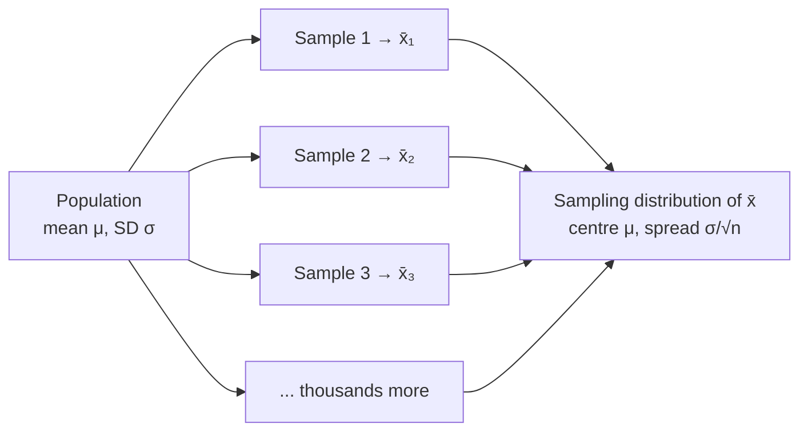

A sampling distribution shows how a statistic, like the sample mean, would come out if you could take every possible sample of the same size and calculate it each time. It's the pattern of "how much would my answer change if I'd drawn a different sample?"

Here's a little puzzle. You weigh 30 tomatoes from a field and get an average. Your friend weighs a different 30 from the same field. Will you get the same average? Of course not. A bit different. Somebody else gets a third answer. So your average isn't a fixed fact about the field; it depends on which tomatoes you happened to grab ([[Parameter vs Statistic]]). Before you pick, it's a number waiting for chance to decide it, a [[Random Variable|random variable]].

Now imagine everybody in the world takes a sample of 30 from that field, and you collect all their averages and draw a [[Histogram|histogram]] of them. That histogram of averages is the sampling distribution ([[Probability Distribution]]). It tells you how far a typical average lands from the true field average, and that is exactly what you need to know how much to trust yours ([[Why the sampling distribution makes inference possible]]).

Let's do one small enough to write out completely. The "population" is just three numbers, 2, 4 and 6. Their mean is 4. Take every possible sample of 2, [[Sampling With and Without Replacement|with replacement]], and find each sample's mean:

| Sample | (2,2) | (2,4) | (2,6) | (4,2) | (4,4) | (4,6) | (6,2) | (6,4) | (6,6) |
|---|---|---|---|---|---|---|---|---|---|
| $\bar{x}$ | 2 | 3 | 4 | 3 | 4 | 5 | 4 | 5 | 6 |

Look at those nine means. They average to exactly 4, the true mean. And they bunch up in the middle: 4 shows up three times, while 2 and 6 show up only once each. The averages are less spread out than the original values. That's not an accident. In an average, a high value and a low value partly cancel.

Now, people mix up three different piles, so let's lay them side by side. The middle one is called the **data distribution**, so it doesn't get confused with the sampling distribution:

| | Population distribution | Data distribution | Sampling distribution |
|---|---|---|---|
| On the x-axis | **individual** values of every member (all adult male heights) | **individual** values in *one* sample | **sample statistics** ($\bar{x}$'s) from all possible samples of size $n$ |
| Centre | $\mu$ (fixed, unknown) | $\bar{x}$ of that sample | $\mu$ |
| Known? | unknown, but fixed | known | **theoretical**; we only ever see one point on it |
| Varies? | no | yes, each sample looks different | it *is* the distribution of that variation |

In real life only one sample is taken; the sampling distribution is the thought [[Experiment|experiment]] of taking all of them.

Here's the strange part. In real life you take one sample. You get one dot on this pile, never the pile itself. So how can it help? Because theory tells us what the pile looks like without our having to see it. The [[Central Limit Theorem|central limit theorem]] says its shape is close to a bell, centred on the true mean, with a spread called the [[Standard Error|standard error]], $\sigma/\sqrt{n}$.

![[Central limit theorem.png|700]]
The population (left) is strongly skewed, yet the means of samples pile up into a bell around μ = 10 and get narrower as n grows. By n = 30 the red normal curve fits almost perfectly.

And once you know the pile's shape, centre and spread, you can reason backwards. "If the true mean were this, would my one average be a normal sort of dot on the pile, or a weird one way out in the tail?" That's the engine of all [[Descriptive vs Inferential Statistics|inference]]: every confidence interval and every test runs on it ([[Why report both center and spread|centre and spread]]).

Try it yourself. If your samples were much bigger, say a few hundred tomatoes instead of 30, what would happen to the pile of averages? It would get narrower. Bigger samples cancel out more of the luck, so the averages crowd closer to the truth. And remember: the histogram of your actual tomatoes is the *data* distribution, not this one. This one you can only imagine, or build in a [[Simulation|simulation]].

See also: [[Population and Sample]], [[Unbiased Estimator]], [[Confidence Interval]], [[Variability]], [[Standard Deviation|standard deviation]].

Further reading: [[References|Vu and Harrington 2020, Ch. 4]] (§4.1, p. 201).
