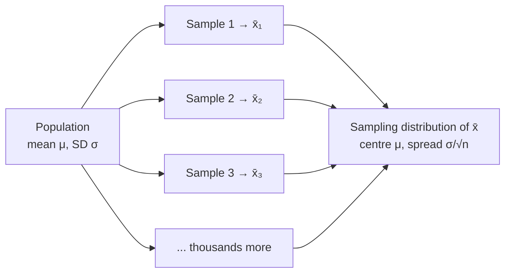

A sampling distribution is the distribution of a statistic, such as the sample mean $\bar{x}$, over all possible samples of the same size from the same population.

This is the most important idea in inference, and the hardest to see, because it describes something nobody ever observes. Start here: a statistic depends on which sample you happened to get. Measure 30 different plants and $\bar{x}$ comes out a bit different ([[Parameter vs Statistic]]). So before you sample, $\bar{x}$ is a random variable: a number decided by chance ([[Random Variable]]). Every random variable has a distribution: the values it can take and how likely each one is ([[Probability Distribution]]).

The sampling distribution is that distribution for a statistic: the values of $\bar{x}$ from *all possible* samples of size $n$, and how often each would occur. We need it because it tells us how far a sample statistic typically lands from the parameter, and every interval and test uses that ([[Why the sampling distribution makes inference possible]]).

Keep three distributions apart. Here the middle one is called the **data distribution** so it isn't confused with the sampling distribution:

| | Population distribution | Data distribution | Sampling distribution |
|---|---|---|---|
| On the x-axis | **individual** values of every member (all adult male heights) | **individual** values in *one* sample | **sample statistics** ($\bar{x}$'s) from all possible samples of size $n$ |
| Centre | $\mu$ (fixed, unknown) | $\bar{x}$ of that sample | $\mu$ |
| Known? | unknown, but fixed | known | **theoretical**; we only ever see one point on it |
| Varies? | no | yes, each sample looks different | it *is* the distribution of that variation |

We never see the sampling distribution directly. We only ever get one point on it, our one $\bar{x}$. Theory supplies the rest. Its centre and spread come from the [[Central Limit Theorem|central limit theorem]], and its spread is the [[Standard Error|standard error]].

In real life only one sample is taken; the sampling distribution is the thought [[Experiment|experiment]] of taking all of them.

![[Central limit theorem.png|700]]
The population (left) is strongly skewed, yet the means of samples pile up into a bell around μ = 10 and get narrower as n grows. By n = 30 the red normal curve fits almost perfectly.

[[Descriptive vs Inferential Statistics|Inference]] rests on knowing the shape, [[Why report both center and spread|centre and spread]] of the sampling distribution. If sample means are roughly normal, centred at $\mu$, with [[Standard Deviation|standard deviation]] $\sigma/\sqrt{n}$, then from our one $\bar{x}$ we can reason backwards about $\mu$.

For example, take the population 2, 4, 6, with mean 4. Here are all samples of size 2 taken [[Sampling With and Without Replacement|with replacement]], and their means:

| Sample | (2,2) | (2,4) | (2,6) | (4,2) | (4,4) | (4,6) | (6,2) | (6,4) | (6,6) |
|---|---|---|---|---|---|---|---|---|---|
| $\bar{x}$ | 2 | 3 | 4 | 3 | 4 | 5 | 4 | 5 | 6 |

The nine means average to exactly 4, which is $\mu$, and they bunch towards the middle more than the original values do.

It's a thought experiment, and a powerful one: by imagining every sample you could have drawn, you learn how much to trust the one you did. The sampling distribution isn't the [[Histogram|histogram]] of your data; that is the data distribution. And you can't observe a sampling distribution except in [[Simulation|simulations]]; in practice it is theoretical.

See also: [[Population and Sample]], [[Unbiased Estimator]], [[Confidence Interval]], [[Variability]].

Further reading: [[References|Vu and Harrington 2020, Ch. 4]] (§4.1, p. 201).
