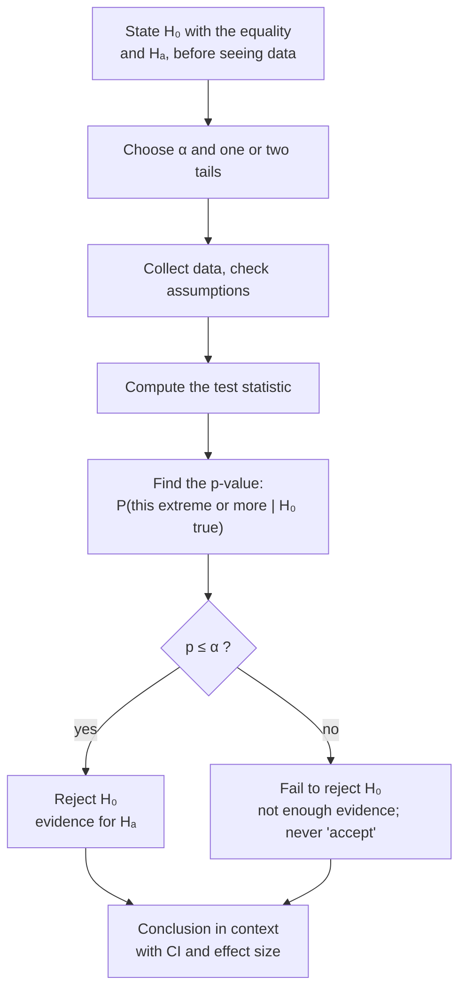

A test's conclusion states the decision (reject or fail to reject the null hypothesis), what that means for the claim in plain words and in context, and the numbers behind it.

By this point the decision is already made: reject or fail to reject $H_0$ ([[Hypothesis Testing]]). Now say it in words a reader can use, in context (the plants, the patients), not just in symbols. "Reject $H_0$" means nothing to someone who never saw your hypotheses.

Use this template:
- **If p ≤ α:** "We **reject $H_0$**. There **is** sufficient evidence to reject $H_0$ and to support the claim that [$H_A$ in words, in context]."
- **If p > α:** "We **fail to reject $H_0$**. There is **not** sufficient evidence to reject $H_0$, and there is **not** sufficient evidence to support the claim that [$H_A$ in words, in context]."

Never say the null is proven. The word "not" matters: failing to find evidence is not the same as finding evidence of no effect ([[Why we never accept the null hypothesis]]).

Then add the numbers that back it up: the [[Test Statistic|test statistic]], the degrees of freedom, the p-value, a [[Confidence Interval|confidence interval]] and an effect size ([[Why report an effect size with the p-value]]).

Every test follows this same path; only the test statistic in the middle changes.

A decision without context is useless to a reader, and loose wording such as "proved" or "accepted the null" claims more than a test can deliver.

For example, for salmonella in ice cream with α = 0.05 and p ≈ 0.029: "We reject $H_0$. There is sufficient evidence to support the claim that the mean salmonella level in the ice cream is greater than 0.3." At α = 0.01 we would fail to reject.

"Fail to reject" doesn't mean the means are equal. It means there isn't enough evidence that they differ.

See also: [[P-Value]], [[Null and Alternative Hypotheses]], [[Effect Size]], [[Post Hoc Tests]], [[report()]].
