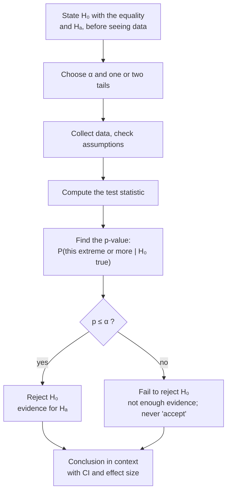

A conclusion says what you decided (reject or fail to reject the null hypothesis), what that means in plain words about the real thing you studied, and the numbers that back it up.

Imagine you've done all the work, and a farmer asks: "So, does the new fertilizer work?" If you answer "we rejected $H_0$ at α = 0.05", you'll get a blank stare. The farmer never saw your $H_0$. All that careful work is wasted if the last step doesn't reach the person who asked.

So the conclusion translates. By this point the decision is made ([[Hypothesis Testing]]). Now say it about the plants, the patients, the ice cream. Here's a template that keeps you honest:
- **If p ≤ α:** "We **reject $H_0$**. There **is** sufficient evidence to reject $H_0$ and to support the claim that [$H_A$ in words, in context]."
- **If p > α:** "We **fail to reject $H_0$**. There is **not** sufficient evidence to reject $H_0$, and there is **not** sufficient evidence to support the claim that [$H_A$ in words, in context]."

Every word is there for a reason. Notice there's no "proved", and no "accepted the null". A test can't do either. Failing to find evidence of an effect is not the same as finding evidence of no effect, just as "not guilty" isn't "innocent" ([[Why we never accept the null hypothesis]]).

Then back it up with numbers: the [[Test Statistic|test statistic]], degrees of freedom, p-value, a [[Confidence Interval|confidence interval]], and an effect size, so the reader knows not only *whether* but *how much* ([[Why report an effect size with the p-value]]).

Every test follows this same path; only the test statistic in the middle changes.

For example, for salmonella in ice cream with α = 0.05 and p ≈ 0.029: "We reject $H_0$. There is sufficient evidence to support the claim that the mean salmonella level in the ice cream is greater than 0.3." At α = 0.01 we would fail to reject.

Try it yourself. A two-sample test gives a large p-value. A friend writes "the two diets have the same effect". What's wrong? It claims too much. The honest version: "there is not sufficient evidence that the two diets differ." Maybe they're the same; maybe the study was too small to tell. Say exactly what the evidence supports, and nothing more.

See also: [[P-Value]], [[Null and Alternative Hypotheses]], [[Effect Size]], [[Post Hoc Tests]], [[report()]].
