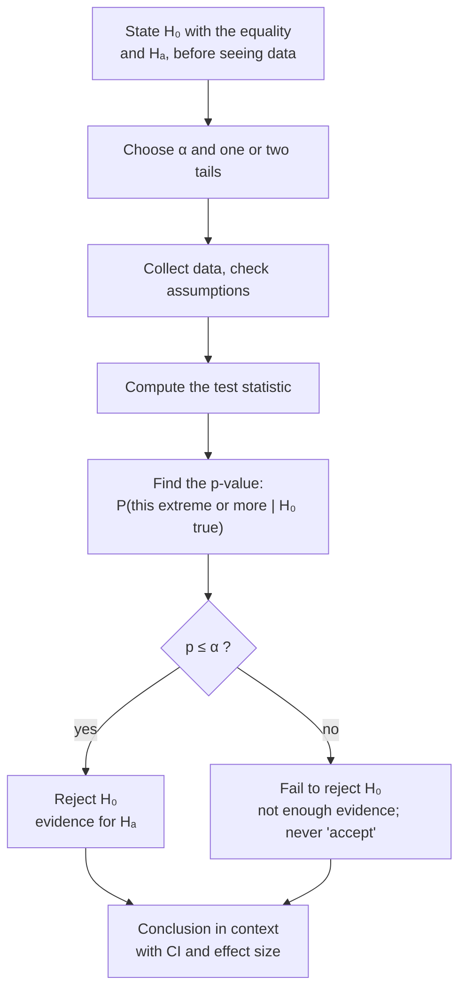

**In one line:** a test's conclusion states the decision (reject or fail to reject $H_0$), what that means for the claim in plain words and in context, and the numbers behind it.

> [!info] Before this, it helps to know
> [[Hypothesis Testing]] (the last step) · [[P-Value]] (the comparison with α) · [[Null and Alternative Hypotheses]] (what the sentence is about)

## Start from zero
1. **The decision is already made:** reject or fail to reject $H_0$ ([[Hypothesis Testing]]).
2. **Say it in words a reader can use, in context** (the plants, the patients), not just in symbols. *Why:* "reject $H_0$" means nothing to someone who never saw your hypotheses.
3. **Use this template:**
   - **p ≤ α:** "We **reject $H_0$**. There **is** sufficient evidence to reject $H_0$ and to support the claim that [$H_A$ in words, in context]."
   - **p > α:** "We **fail to reject $H_0$**. There is **not** sufficient evidence to reject $H_0$, and there is **not** sufficient evidence to support the claim that [$H_A$ in words, in context]."
4. **Never say the null is proven.** *Why the "not" wording:* failing to find evidence is not finding evidence of no effect ([[Why we never accept the null hypothesis]]).

> "The word *not* is fundamental." You have a car / you do *not* have a car.

5. **Add the numbers that back it up:** the [[Test Statistic|test statistic]], df, p-value, a [[Confidence Interval|confidence interval]] and an effect size ([[Why report an effect size with the p-value]]).

## See it

*What to look at:* every test follows this same path; only the test statistic in the middle changes.

## Why it exists
A decision without context is useless to a reader, and loose wording ("proved", "accepted the null") claims more than a test can deliver ([[Why we never accept the null hypothesis]]).

## A tiny example
Salmonella, α = 0.05, p ≈ 0.029: "We reject $H_0$. There is sufficient evidence to support the claim that the mean salmonella level in the ice cream is greater than 0.3." At α = 0.01 we would fail to reject.

## Common confusions
- **"Fail to reject means the means are equal."** It means there isn't enough evidence that they differ.

## Connections
- **Builds on:** [[Hypothesis Testing]], [[P-Value]], [[Null and Alternative Hypotheses]]
- **Leads to:** [[Effect Size]], [[Post Hoc Tests]], [[report()]]
- **Part of:** [[MOC - Inference Foundations]]
