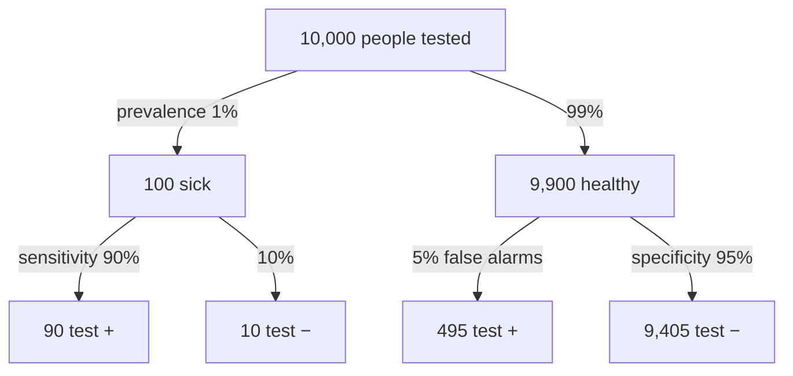

Bayes' theorem turns a conditional probability around. It goes from "how likely is a positive test if you have the disease?" to "how likely is the disease if you test positive?".

A test maker reports $P(+ \mid \text{disease})$, but a patient wants $P(\text{disease} \mid +)$. These are different numbers because they are shares of different groups ([[Conditional Probability]]). To get from one to the other:

1. Start from the definition: $P(A \mid B) = P(A \cap B)/P(B)$.
2. Rewrite the top with the [[Multiplication Rule]]: $P(A \cap B) = P(B \mid A)P(A)$. This is the "true" route to a positive test.
3. Rewrite the bottom by adding every way $B$ can happen. A positive test can come from a sick person or a healthy one: $P(B) = P(B \mid A)P(A) + P(B \mid A^c)P(A^c)$.
4. Put them together:
$$P(A \mid B) = \frac{P(B \mid A)\,P(A)}{P(B \mid A)\,P(A) + P(B \mid A^c)\,P(A^c)}$$

The new ingredient is $P(A)$, how common the condition is to begin with, called the prevalence. When the condition is rare, there are so many healthy people that their false positives can outnumber the true positives ([[Predictive Values and Prevalence]]). You can get the same answer with less algebra by filling in counts for an imaginary group of people and reading across a table ([[Contingency Table]]).

[[Sensitivity and Specificity|Sensitivity and specificity]] are read down the branches. The predictive values are read across the bottom row: the chance of being sick after a positive test is 90 / (90 + 495) ≈ 15%, and the chance of being healthy after a negative one is 9,405 / (9,405 + 10) ≈ 99.9%. These are made-up numbers.

Without Bayes' theorem, people mix up the two directions, and a positive screening result gets read as near-certain disease.

For example, in the book's mammography example ([[References|Vu and Harrington 2020, Ch. 2]], pp. 112–116), the prevalence is 0.35%, the sensitivity 0.89 and the specificity 0.93. Imagine 100,000 women:

| | Cancer | No cancer | Total |
|---|---|---|---|
| Test + | 311.5 | 6,975.5 | 7,287 |
| Test − | 38.5 | 92,674.5 | 92,713 |
| Total | 350 | 99,650 | 100,000 |

$P(\text{cancer} \mid +) = 311.5 / 7{,}287 \approx 0.043$, or about 4%.

A test that catches most cases doesn't make a positive result reliable when the condition is rare. And Bayes' theorem isn't only for "Bayesian statistics": it is a basic rule of probability.

See also: [[Why a positive test can still mean you are probably healthy]].

Further reading: [[References|Vu and Harrington 2020, Ch. 2]] (pp. 111–116).
