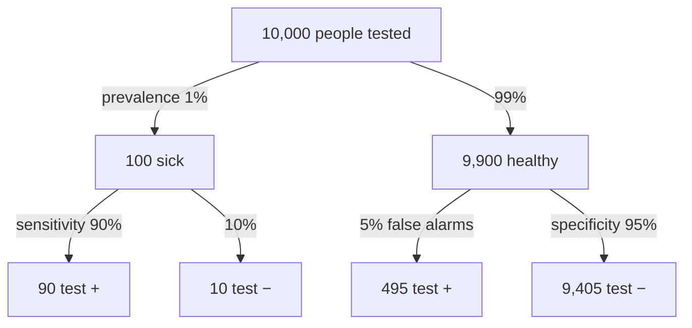

**In one line:** Bayes' theorem flips a conditional probability around: from "how likely is a positive test if you have the disease" to "how likely is the disease if you test positive".

> [!info] Before this, it helps to know
> [[Conditional Probability]] (what gets flipped) · [[Multiplication Rule]] (where the formula comes from) · [[Contingency Table]] (the easy way to do it)

## Start from zero
1. **A test company tells you $P(+ \mid \text{disease})$. A patient wants $P(\text{disease} \mid +)$.** Those are different numbers: different wholes ([[Conditional Probability]]).
2. **Write what you want with the definition:** $P(A \mid B) = P(A \cap B)/P(B)$.
3. **Rebuild the top with the multiplication rule:** $P(A \cap B) = P(B \mid A)P(A)$, the "true route" to $B$ ([[Multiplication Rule]]).
4. **Rebuild the bottom by adding every route to $B$:** through $A$ and through not-$A$, $P(B) = P(B \mid A)P(A) + P(B \mid A^c)P(A^c)$. *Why every route:* a positive test can come from a sick person or from a healthy one.
5. **Put them together:**
$$P(A \mid B) = \frac{P(B \mid A)\,P(A)}{P(B \mid A)\,P(A) + P(B \mid A^c)\,P(A^c)}$$
6. **The extra ingredient is $P(A)$, how common $A$ is to begin with (the prevalence).** *Why it matters so much:* when $A$ is rare, the "false route" through the many people without $A$ can outnumber the true route ([[Predictive Values and Prevalence]]).
7. **The table route gives the same answer with less algebra:** fill in counts for an imaginary 1,000 people and read across ([[Contingency Table]]).

## See it

*What to look at:* [[Sensitivity and Specificity|sensitivity and specificity]] are read down the branches. PPV and NPV are read across the bottom row: PPV = 90 / (90 + 495) ≈ 15%, NPV = 9,405 / (9,405 + 10) ≈ 99.9%. Made-up numbers.

## Why it exists
Without it, people confuse the two directions, which is how a positive screening result gets misread as near-certain disease. It is the engine behind [[Predictive Values and Prevalence]].

## A tiny example
Book mammography example ([[References|Vu and Harrington 2020, Ch. 2]], pp. 112–116): prevalence 0.35%, sensitivity 0.89, specificity 0.93. Build a **hypothetical population** of 100,000 women:

| | Cancer | No cancer | Total |
|---|---|---|---|
| Test + | 311.5 | 6,975.5 | 7,287 |
| Test − | 38.5 | 92,674.5 | 92,713 |
| Total | 350 | 99,650 | 100,000 |

$P(\text{cancer} \mid +) = 311.5 / 7{,}287 \approx 0.043$. About 4%.

## Common confusions
- **"High sensitivity means a positive result is reliable."** Not when the condition is rare; prevalence drags the answer down.
- **"Bayes' theorem is only for Bayesian statistics."** It is a basic probability rule; Bayesian analysis is a later, broader idea.

## Connections
- **Builds on:** [[Conditional Probability]], [[Multiplication Rule]], [[Contingency Table]]
- **Leads to:** [[Predictive Values and Prevalence]], [[Why a positive test can still mean you are probably healthy]]
- **Part of:** [[MOC - Probability]]
- **Go deeper:** [[References|Vu and Harrington 2020, Ch. 2]] (pp. 111–116)
