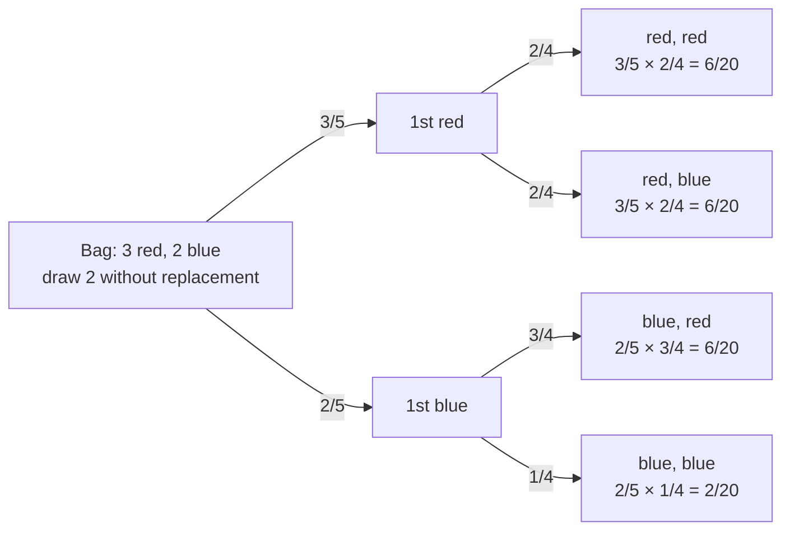

**In one line:** the chance that $A$ and $B$ both happen is the chance of $A$ times the chance of $B$ given that $A$ already happened.

> [!info] Before this, it helps to know
> [[Conditional Probability]] (the 'given A' part) · [[Independent Events]] (when the rule simplifies)

## Start from zero
1. **Question: what's the chance that A and B both happen?** For example two clubs in a row from a deck, without putting the first back.
2. **Break it into stages.** First the first card must be a club (13/52).
3. **Then, given that, the second must be a club.** The deck has changed: now 12/51 ([[Conditional Probability]]).
4. **Multiply the stages:**
$$P(A \text{ and } B) = P(A \cap B) = P(A)\,P(B \mid A) = P(B)\,P(A \mid B)$$
   *Why multiply:* the second stage only happens in the fraction of cases where the first did, so you take a fraction of a fraction. Make sure the conditioning in the second factor matches the first factor.
5. **If the events are independent, the second stage doesn't care about the first**: $P(B \mid A) = P(B)$, and the rule becomes $P(A)\,P(B)$ ([[Independent Events]]).
6. **Rearranged, it is the definition of conditional probability**, and it is the engine inside Bayes' theorem ([[Bayes' Theorem]]).

## See it

*What to look at:* multiply along a branch (the second probability is conditional on the first draw), and the four ends add to 20/20. Made-up example.

## Why it exists
Many questions ask about a chain of events. The rule extends to any length: $P(A \cap B \cap C) = P(A)\,P(B \mid A)\,P(C \mid A \cap B)$. Rearranged, it *is* the definition of [[Conditional Probability]].

## A tiny example
Examples:
1. Two fives on two fair dice (independent): $\frac16 \times \frac16 = \frac{1}{36}$
2. Two clubs [[Sampling With and Without Replacement|without replacement]] ("stair-step down"): $\frac{13}{52} \times \frac{12}{51} \approx 0.059$
3. Marbles (5 red, 11 white, 4 blue = 20) drawn without replacement as red, red, white: $\frac{5}{20} \times \frac{4}{19} \times \frac{11}{18} \approx 0.032$
4. 20 heads in a row with a fair coin: $0.5^{20} \approx 0.00000095$ ([[Rare Event Rule]])

## Common confusions
- **"Multiply the plain probabilities always."** Only for independent events. Without replacement, the second factor must be conditional.
- **"And makes probabilities bigger."** Multiplying numbers below 1 always gives something smaller: both things happening is less likely than either alone.

## Connections
- **Builds on:** [[Conditional Probability]], [[Independent Events]]
- **Leads to:** [[Rare Event Rule]], [[Family-Wise Type I Error]], [[Bayes' Theorem]]
- **Part of:** [[MOC - Probability]]
- **Go deeper:** [[References|Vu and Harrington 2020, Ch. 2]] (§2.2, p. 106)
