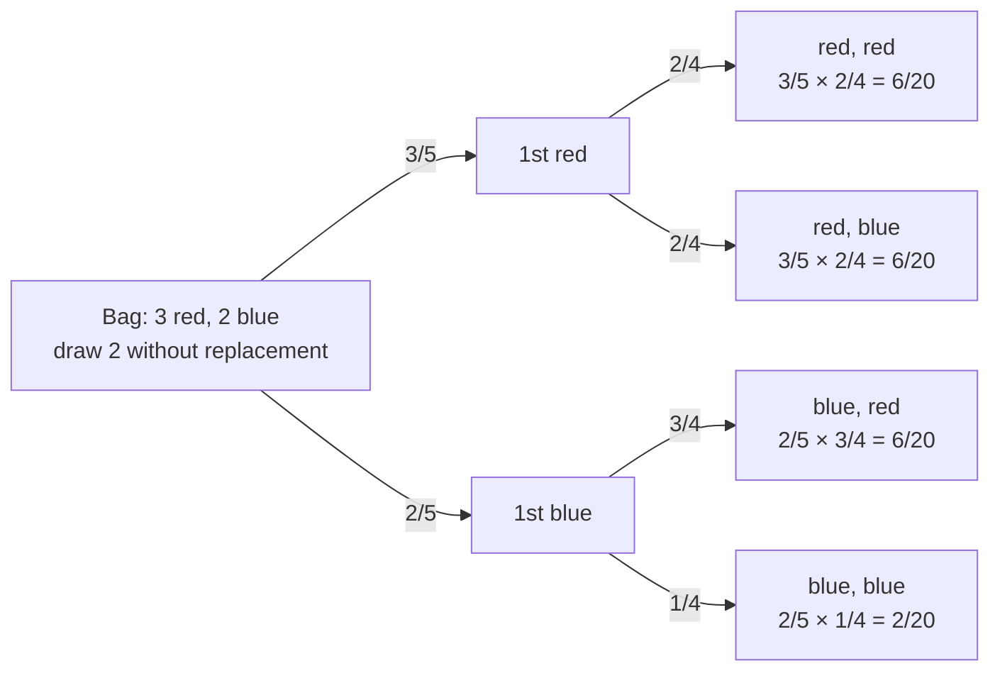

The chance that $A$ and $B$ both happen is the chance of $A$, times the chance of $B$ given that $A$ already happened.

To get the chance that several things all happen, you break the story into steps and multiply. Take the chance of drawing two clubs in a row from a deck, without putting the first card back. Break it into stages. First, the first card must be a club: 13/52. Then, given that, the second must be a club too. The deck has changed, so that chance is now 12/51 ([[Conditional Probability]]). Multiply the stages:
$$P(A \text{ and } B) = P(A \cap B) = P(A)\,P(B \mid A) = P(B)\,P(A \mid B)$$
You multiply because the second stage only matters in the share of cases where the first one happened: it is a fraction of a fraction.

If the events are independent, the second stage doesn't depend on the first, so $P(B \mid A) = P(B)$ and the rule becomes $P(A)\,P(B)$ ([[Independent Events]]). The rule also works for longer chains: $P(A \cap B \cap C) = P(A)\,P(B \mid A)\,P(C \mid A \cap B)$. Rearranged, it gives the definition of conditional probability, and it is the core of [[Bayes' Theorem]].

Multiply along each branch; the second probability depends on the first draw. The four ends add to 20/20. This is a made-up example.

Some examples:
1. Two fives on two fair dice (independent): $\frac16 \times \frac16 = \frac{1}{36}$
2. Two clubs [[Sampling With and Without Replacement|without replacement]]: $\frac{13}{52} \times \frac{12}{51} \approx 0.059$
3. Marbles (5 red, 11 white, 4 blue, so 20 in all) drawn without replacement as red, red, white: $\frac{5}{20} \times \frac{4}{19} \times \frac{11}{18} \approx 0.032$
4. 20 heads in a row with a fair coin: $0.5^{20} \approx 0.00000095$ ([[Rare Event Rule]])

Tell the story in order, and at each step ask what you know by then. You can only multiply the plain probabilities when the events are independent. Without replacement, the second factor must be the conditional one. Also, "and" always makes a probability smaller: both things happening is less likely than either one alone.

Try it yourself. What's the chance of rolling a 6 and then another 6 with a fair die? The second roll doesn't care about the first, so it's 1/6 × 1/6 = 1/36. Now: what's the chance of drawing two aces in a row from a deck without putting the first back? 4/52 × 3/51, because after the first ace, there are only 3 aces and 51 cards left.

See also: [[Family-Wise Type I Error]].

Further reading: [[References|Vu and Harrington 2020, Ch. 2]] (§2.2, p. 106).
