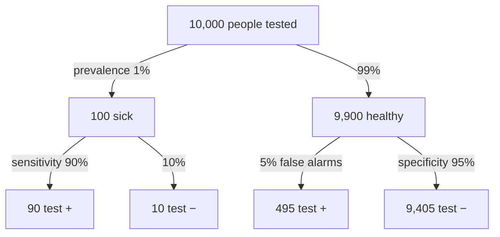

The positive predictive value (PPV) is the chance you really have the condition after a positive test; the negative predictive value (NPV) is the chance you are really clear after a negative one; both depend on how common the condition is (prevalence).

1. **Sensitivity and specificity condition on the true status** ([[Sensitivity and Specificity]]). A patient knows only the result.
2. **So flip the condition.** A patient does not care how the test performs in sick people; they care what *their* result means:
   - **PPV** $= P(\text{disease} \mid +)$
   - **NPV** $= P(\text{healthy} \mid -)$
3. **Flipping needs one more ingredient: prevalence** $= P(\text{disease})$ in the population being tested ([[Bayes' Theorem]]).
4. **Apply Bayes:**
$$\text{PPV} = \frac{\text{sens} \times \text{prev}}{\text{sens} \times \text{prev} + (1-\text{spec})(1-\text{prev})}$$
   *Why prevalence dominates when it is low:* the bottom adds [[Type I and Type II Errors|false positives]] from the huge healthy group, $(1 - \text{spec})(1 - \text{prev})$, which can swamp the true positives from the small sick group ([[Why a positive test can still mean you are probably healthy]]).
5. **The same test has different predictive values in different populations.** *Why:* sensitivity and specificity stay fixed, but prevalence changes.

![[Positive predictive value - natural frequencies.png|700]]
Top: the sick are a thin sliver of everyone. Bottom: among those who test positive, the false alarms from the huge healthy group outnumber the true positives, so PPV is only about 15%.

Sensitivity and specificity are read down the branches. PPV and NPV are read across the bottom row: PPV = 90 / (90 + 495) ≈ 15%, NPV = 9,405 / (9,405 + 10) ≈ 99.9%. Made-up numbers.

When a condition is rare, even a good test's false positives can outnumber its true positives, because there are so many more healthy people to make mistakes on. PPV makes that visible.

For example:

- **DVT test**: PPV $= 51/83 \approx 0.614$ (restrict to the positive row) ([[Sensitivity and Specificity]]).
- **Mammography** (book): prevalence 0.35% → PPV ≈ **0.043**. A positive mammogram means about a 4% chance of cancer ([[Bayes' Theorem]]).

Common mistakes:

- **"PPV is a fixed property of the test."** Move the test to a population with a different prevalence and the PPV moves.
- **"A 4% PPV means the test is useless."** It still raises the chance from 0.35% to 4%, which justifies follow-up testing.

See also: [[Conditional Probability]].

Further reading: [[References|Vu and Harrington 2020, Ch. 2]] (pp. 112–116).
