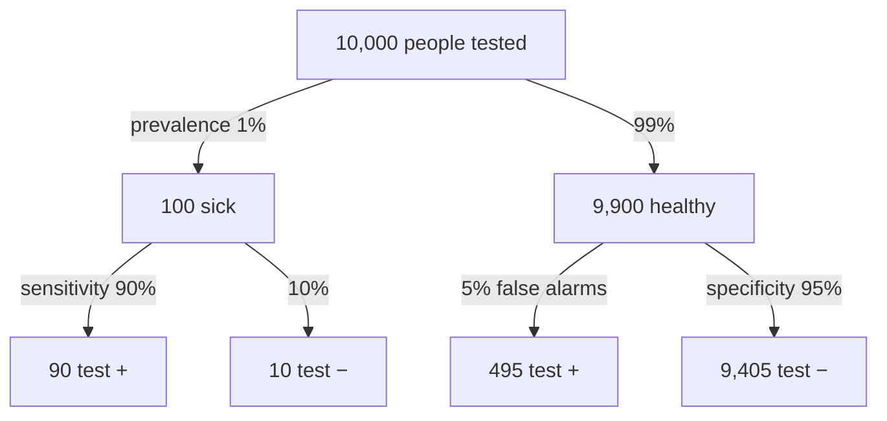

The positive predictive value (PPV) is the chance you really have a condition after a positive test. The negative predictive value (NPV) is the chance you are really clear after a negative test. Both depend on how common the condition is, which is called the prevalence.

A test result is only as meaningful as the population it's used in. This is where most people's intuition about testing breaks. [[Sensitivity and Specificity|Sensitivity and specificity]] describe how a test performs in people whose true status is known. A patient doesn't know their status, only their result, so they need the question turned around:
- PPV $= P(\text{disease} \mid +)$
- NPV $= P(\text{healthy} \mid -)$

Turning it around needs one more number, the prevalence: $P(\text{disease})$ in the group being tested. [[Bayes' Theorem]] then gives:
$$\text{PPV} = \frac{\text{sens} \times \text{prev}}{\text{sens} \times \text{prev} + (1-\text{spec})(1-\text{prev})}$$
When the prevalence is low, the second part of the bottom line, the false positives from the huge healthy group, can swamp the true positives from the small sick group ([[Type I and Type II Errors]]). So the same test gives different predictive values in different populations: sensitivity and specificity stay fixed, but the prevalence changes.

![[Positive predictive value - natural frequencies.png|700]]
Top: the sick are a thin sliver of everyone. Bottom: among those who test positive, the false alarms from the huge healthy group outnumber the true positives, so PPV is only about 15%.

Sensitivity and specificity are read down the branches. PPV and NPV are read across the bottom row: PPV = 90 / (90 + 495) ≈ 15%, NPV = 9,405 / (9,405 + 10) ≈ 99.9%. These are made-up numbers.

For example:
- For a blood clot (DVT) test, PPV $= 51/83 \approx 0.614$: take only the row of positive tests ([[Sensitivity and Specificity]]).
- In the book's mammography example, the prevalence is 0.35%, which gives a PPV of about **0.043**. A positive mammogram means about a 4% chance of cancer ([[Bayes' Theorem]]).

That suggests the practical fix: test twice. A positive first result moves a person from the general population into a group where the condition is far more common. Run a second, independent test on that group and its predictive value is much higher, because the prevalence it works against is now much higher. This is why screening is usually followed by confirmation.

So each pair of numbers has its own job. Sensitivity and specificity describe the test and travel between populations; predictive values are what a patient or clinician actually needs, and they change with prevalence.

Before trusting a positive result, ask how common the condition was to begin with. PPV is not a fixed property of a test: move the test to a population with a different prevalence and the PPV moves too. And a 4% PPV doesn't make a test useless. It still raises the chance from 0.35% to 4%, which is enough to justify follow-up testing.

Try it yourself. The same test is used in a specialist clinic, where most patients really have the disease, and in a general screening of everyone in a town. Where is a positive result more trustworthy? In the clinic. The test is the same, but higher prevalence means a positive is far more likely to be a true positive.

See also: [[Conditional Probability]], [[Why a positive test can still mean you are probably healthy]].

Further reading: [[References|Vu and Harrington 2020, Ch. 2]] (pp. 112–116).
