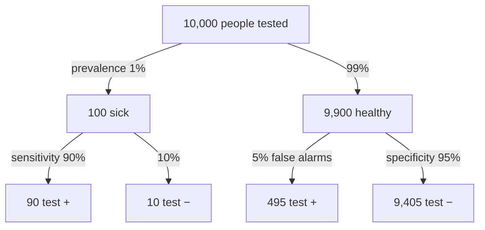

**In one line:** sensitivity is how often a test is positive in people who have the condition; specificity is how often it is negative in people who don't.

> [!info] Before this, it helps to know
> [[Conditional Probability]] (both are 'given' probabilities) · [[Contingency Table]] (where they are read off)

## Start from zero
1. **A diagnostic test can be right in two ways and wrong in two ways:**

| | Has condition | Doesn't |
|---|---|---|
| Test + | true positive | **false positive** |
| Test − | **false negative** | true negative |

2. **Judge the test separately in the two kinds of people.** *Why separately:* a test can be great at catching the sick and bad at clearing the healthy, or the reverse.
3. **Among people who have the condition: sensitivity** (true positive rate) $= P(+ \mid \text{disease})$, the share the test catches. How *sensitive* it is to the disease.
4. **Among people who don't: specificity** (true negative rate) $= P(- \mid \text{healthy})$, the share correctly cleared.
5. **The error rates are the complements:** false positive rate $= 1 - \text{specificity}$; false negative rate $= 1 - \text{sensitivity}$ ([[Complementary Events]]).
6. **These describe the test, not the patient.** *Why that matters:* a patient needs the flip, $P(\text{disease} \mid +)$, which also depends on prevalence ([[Predictive Values and Prevalence]], [[Bayes' Theorem]]).

## See it

*What to look at:* sensitivity and specificity are read down the branches. PPV and NPV are read across the bottom row: PPV = 90 / (90 + 495) ≈ 15%, NPV = 9,405 / (9,405 + 10) ≈ 99.9%. Made-up numbers.

## Why it exists
These describe **the test itself**, so they let you compare tools. Crucially, **they do not change with prevalence**: a test performs the same whether the disease is rare or common. What a result means for one patient does change; that is [[Predictive Values and Prevalence]].

## A tiny example
DVT and the SimpliRED D-dimer test (51, 59, 62, 83 and 30 are given; the other cells follow from those totals):

| | DVT | No DVT | Total |
|---|---|---|---|
| Test + | 51 | 32 | 83 |
| Test − | 8 | 30 | 38 |
| Total | 59 | 62 | 121 |

- Sensitivity $= 51/59 \approx 0.864$ (restrict to the DVT column)
- Specificity $= 30/62 \approx 0.484$ ("not the best specificity")

## Common confusions
- **"Sensitivity is the chance I'm sick if I test positive."** That is the PPV.
- **"A specific test is a sensitive test."** They are separate; a test can be very sensitive and poorly specific, like the D-dimer.

## Connections
- **Builds on:** [[Conditional Probability]], [[Contingency Table]]
- **Leads to:** [[Predictive Values and Prevalence]], [[Type I and Type II Errors]]
- **Part of:** [[MOC - Probability]]
- **Go deeper:** [[References|Vu and Harrington 2020, Ch. 2]] (pp. 112–114)
