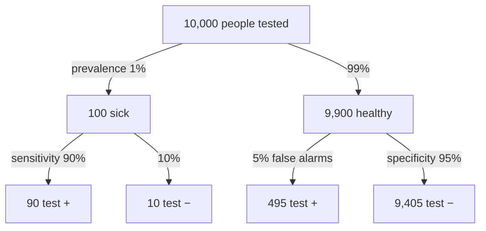

Sensitivity is how often a test is positive in people who have the condition. Specificity is how often it is negative in people who don't.

A diagnostic test can be right in two ways and wrong in two ways:

| | Has condition | Doesn't |
|---|---|---|
| Test + | true positive | **false positive** |
| Test − | **false negative** | true negative |

So judge the test separately in the two groups, because a test can be good at catching sick people and bad at clearing healthy ones, or the other way round. Among people who have the condition, the **sensitivity**, or true positive rate, is $P(+ \mid \text{disease})$: the share the test catches. Among people who don't, the **specificity**, or true negative rate, is $P(- \mid \text{healthy})$: the share it correctly clears. The error rates are what's left over: the false positive rate is $1 - \text{specificity}$ and the false negative rate is $1 - \text{sensitivity}$ ([[Complementary Events]]).

These numbers describe the test, not the patient. They let you compare tests, and they don't change with how common the condition is. A patient needs the question turned around, $P(\text{disease} \mid +)$, which does depend on how common the condition is ([[Predictive Values and Prevalence]], [[Bayes' Theorem]]).

Sensitivity and specificity are read down the branches. The predictive values are read across the bottom row: the chance of being sick after a positive test is 90 / (90 + 495) ≈ 15%, and the chance of being healthy after a negative test is 9,405 / (9,405 + 10) ≈ 99.9%. These are made-up numbers.

For example, here is the SimpliRED D-dimer test for blood clots in the leg (DVT). The values 51, 59, 62, 83 and 30 are given; the other cells follow from the totals.

| | DVT | No DVT | Total |
|---|---|---|---|
| Test + | 51 | 32 | 83 |
| Test − | 8 | 30 | 38 |
| Total | 59 | 62 | 121 |

- Sensitivity $= 51/59 \approx 0.864$, using only the DVT column.
- Specificity $= 30/62 \approx 0.484$, which is poor.

Sensitivity is not "the chance I'm sick if I test positive"; that is the [[Predictive Values and Prevalence|positive predictive value]]. And a sensitive test isn't automatically specific: the D-dimer test is very sensitive but poorly specific.

See also: [[Conditional Probability]], [[Contingency Table]], [[Type I and Type II Errors]].

Further reading: [[References|Vu and Harrington 2020, Ch. 2]] (pp. 112–114).
