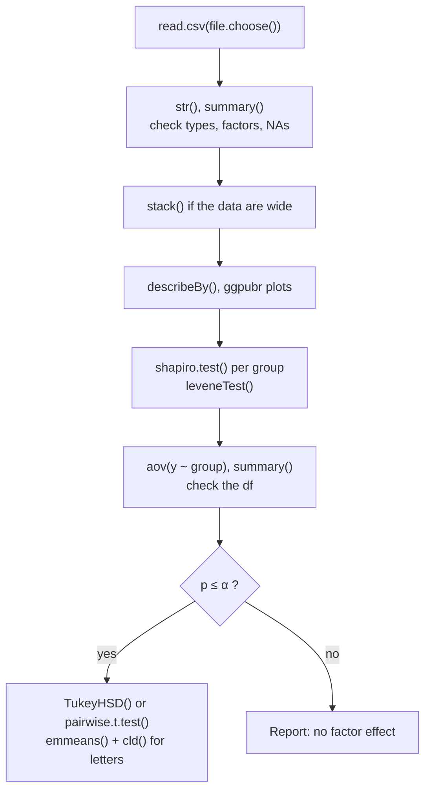

**In one line:** `aov(response ~ factor, data = d)` fits a one-way ANOVA, and `summary()` on the result prints the ANOVA table with F and p.

> [!info] Before this, it helps to know
> [[One-Way ANOVA]] · [[ANOVA Table]] · [[Wide vs Long Format]] · [[factor()]]

## Start from zero
1. **One-way ANOVA fits the model "response = group mean + error"** ([[One-Way ANOVA]], [[Statistical Model]]).
2. **`aov()` fits it from a formula `response ~ factor`.** The data must be long and the group a factor ([[Wide vs Long Format]], [[factor()]]). *Why a factor:* a numeric group would fit a straight line instead of separate means.
3. **Store the fit, then ask for the table with `summary()`** ([[ANOVA Table]]). *Why store it:* `TukeyHSD()`, `residuals()` and plots all need the fitted model.
4. **Check the df first:** $k - 1$ for the factor and $N - k$ for [[Residuals|residuals]] ([[Why use degrees of freedom as a sanity check]]).

```r
frustration.aov <- aov(score ~ major, data = frust)   # response ~ factor
summary(frustration.aov)                               # check df: k - 1 = 3, N - k
# Same F and p from the GLM family (gaussian = normal):
frustration.glm <- glm(score ~ major, family = gaussian, data = frust)
anova(frustration.glm, test = "F")
```

5. **Why the `glm` lines:** ANOVA is a special case of a general linear model with normal errors, the family later courses build on.

## See it


*What to look at:* the order of a typical ANOVA script, from reading the file to letters.

## Why it exists
It is the omnibus test. The data must be long, with the group as a factor ([[stack()]], [[str()]]).

## A tiny example
```
             Df Sum Sq Mean Sq F value Pr(>F)
major         3   ...     ...    ...    <0.001
Residuals   116   ...     ...
```
df 3 → 4 majors; 3 + 116 + 1 = 120 students. If the first df is 1, the factor was read as a number ([[Why use degrees of freedom as a sanity check]]).

## Common confusions
- **"aov() prints the table."** Print it with `summary()`.

## Connections
- **Builds on:** [[One-Way ANOVA]], [[ANOVA Table]], [[factor()]]
- **Leads to:** [[TukeyHSD()]], [[pairwise.t.test()]], [[emmeans() and cld()]]
- **Part of:** [[MOC - R for Statistics]], [[MOC - ANOVA]]
- **Go deeper:** [[References|Vu and Harrington 2020, Ch. 5]] (p. 269)
