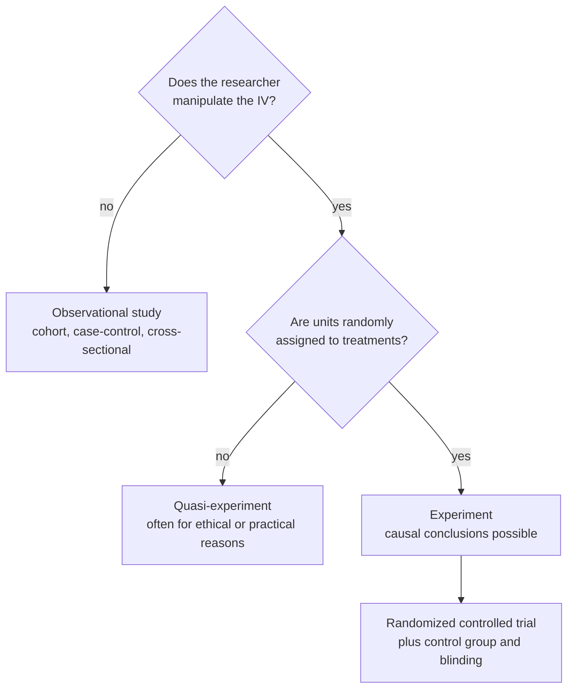

**In one line:** in an experiment the researcher manipulates the independent variable and randomly assigns units to treatments, which is what allows a [[Association vs Causation|causal]] conclusion.

> [!info] Before this, it helps to know
> [[Independent and Dependent Variables]] (what is manipulated and measured) · [[Random Assignment]] (the ingredient that makes causation possible)

## Start from zero
1. **I want to know whether X causes Y** ([[Independent and Dependent Variables]]).
2. **Watching what happens naturally isn't enough,** because something else might drive both ([[Nuisance Variables and Confounding]]).
3. **So the standard definition (Kirk 2013) requires three things,** each with a job:
   1. **Manipulation** by the researcher of one or more IVs (2 mg, 4 mg or 8 mg of a substance). *Why:* the researcher, not some hidden variable, decides who gets what.
   2. **Random assignment** of experimental units to treatment groups (3 seeds here, 3 seeds there). *Why:* nuisance variables end up balanced across groups ([[Random Assignment]]).
   3. **Observation or measurement** of one or more DVs. *Why:* the effect has to show up in data.
4. **Together they let a difference in outcomes be blamed on the treatment.** R. A. Fisher: an experiment is "an experience carefully planned in advance and designed to form a secure basis of new knowledge." It **permits the [[Descriptive vs Inferential Statistics|inference]] of causation** ([[Internal Validity]]).
5. **If manipulation or random assignment is impossible, it is a [[Quasi-Experiment]].**

## See it

*What to look at:* two yes/no questions separate the three kinds of study, and only the bottom path supports a causal claim.

## Why it exists
Manipulation guarantees the IV came first. Random assignment means nuisance variables are balanced between groups on average, so the only systematic difference is the treatment. Together they protect [[Internal Validity]].

## A tiny example
The book's four principles of experimental design ([[References|Vu and Harrington 2020, Ch. 1]], pp. 25–27):
1. **Controlling:** treat the groups identically except for the treatment; use a [[Treatment and Control Groups|control group]] and, where possible, a [[Blinding and Placebo|placebo]].
2. **Randomization:** randomly assign units so nuisance variables even out.
3. **Replication:** use enough units (and replicate whole studies; science has "lots of one-offs").
4. **Blocking:** group units by a known nuisance variable, then randomize within blocks ([[Nuisance Variables and Confounding]]).

## Common confusions
- **"Any study with a control group is an experiment."** Without random assignment it is quasi-experimental.
- **"Experiments generalize well."** Tight control often *lowers* [[External Validity|external validity]] ([[Why RCTs trade external validity for internal validity]]).

## Connections
- **Builds on:** [[Independent and Dependent Variables]], [[Random Assignment]]
- **Leads to:** [[Quasi-Experiment]], [[Randomized Controlled Trial]], [[Internal Validity]]
- **Part of:** [[MOC - Study Design and Sampling]]
- **Go deeper:** [[References|Kirk 2013, Ch. 1]], [[References|Vu and Harrington 2020, Ch. 1]] (§1.3)
